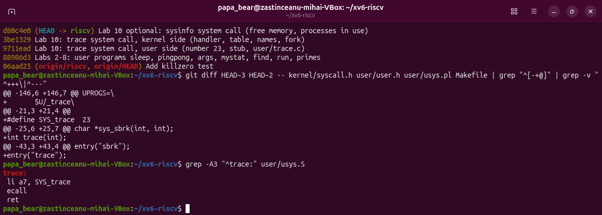
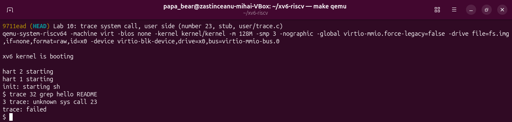
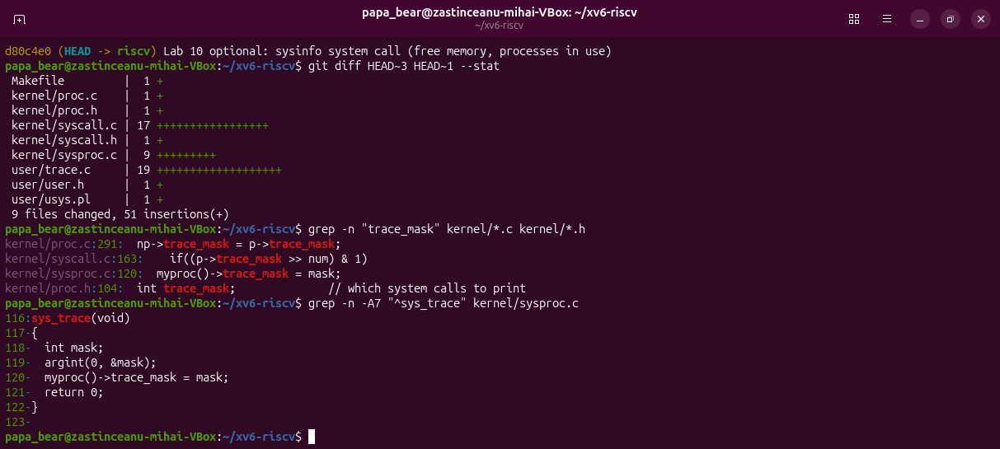
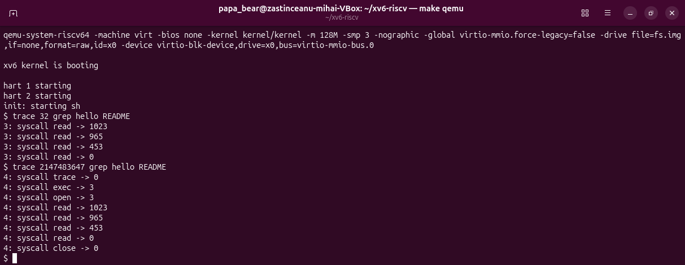
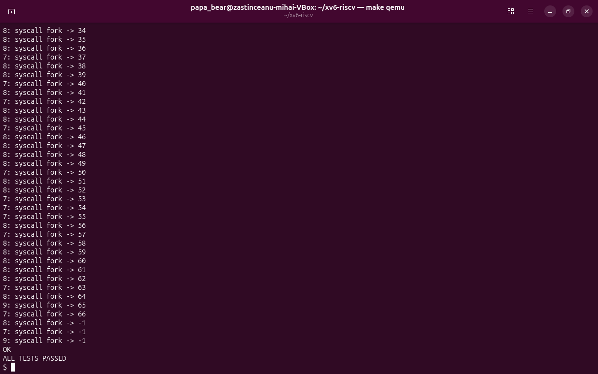
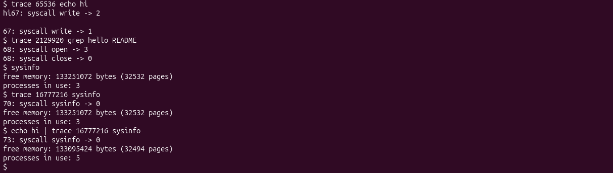

# Lab 10 – Add Your Own System Call: trace (xv6)

Zastinceanu Mihai, FAF-243. The complete report is also available as the .docx file.

## AIM OF THE WORK

### Purpose of the practical work

The purpose of the work is to change the kernel of xv6 for the first time, by adding a new system call, trace, which makes a process print every system call it makes [4]; in the ninth laboratory work strace did this on Linux, and here it is built by hand [1]. The number 23 of the new call is followed from a user program, through the stub that executes ecall, down to a function in the kernel. The work was done with xv6-riscv commit 06aad25, the cross compiler riscv64-linux-gnu-gcc 15.2.0 (with -Werror) and QEMU 10.2.1.

### Problem statement

The following tasks have to be solved:

- to give the new call the number 23 and to teach the user side to ask for it (user.h, usys.pl, user/trace.c, Makefile)
- to write the kernel side: a place for the mask in struct proc, the handler sys_trace, the entry in the table of calls, the table of names with the print, and the inheritance of the mask in fork
- to run trace with different masks and to answer the questions about the results
- to add the optional system call sysinfo, which returns the free memory and the number of processes in use

## 1 THE NUMBER AND THE USER SIDE

### 1.1 Theoretical background

In xv6 a user program does not call the kernel directly: it calls a stub generated by the script user/usys.pl, which loads the number of the system call into the register a7 and executes the instruction ecall [2]. The processor then jumps into the kernel, where the function syscall() in kernel/syscall.c reads a7 and uses it as an index in the table syscalls[] of handlers; the return value of the handler is put in the register a0, which the user program receives as the result [2], [3].

### 1.2 Work performed

The five edits of the first part were made: the line #define SYS_trace 23 in kernel/syscall.h (the number 22 is already used by sync in this tree), the declaration int trace(int) in user/user.h, the line entry("trace") in user/usys.pl, the new program user/trace.c (Listing 1.1) and the line $U/_trace\ in the UPROGS list of the Makefile. The changes were committed to the git repository of xv6 in separate commits for the user side, the kernel side and the optional part (Figure 1.1); the generated file user/usys.S shows that trace became the three instructions li a7, SYS_trace; ecall; ret.

```
#include "kernel/types.h"
#include "kernel/stat.h"
#include "user/user.h"

int
main(int argc, char *argv[])
{
  if (argc < 3) {
    fprintf(2, "usage: trace mask command [args...]\n");
    exit(1);
  }
  if (trace(atoi(argv[1])) < 0) {
    fprintf(2, "trace: failed\n");
    exit(1);
  }
  exec(argv[2], argv + 2);
  fprintf(2, "trace: exec %s failed\n", argv[2]);
  exit(1);
}
```

*Listing 1.1 – The program user/trace.c*



*Figure 1.1 – The commits of the work, the user side changes and the stub in user/usys.S*

For the first check, the tree was built at the commit with only the user side (9711ead) and the command trace 32 grep hello README was run (Figure 1.2). The kernel answered "3 trace: unknown sys call 23" and the program printed "trace: failed", exactly as the handout expects: the program executed ecall with a7 = 23 and the kernel received the number, but did not have a function for it yet.



*Figure 1.2 – Check 1: the number 23 reaches the kernel*

## 2 THE KERNEL SIDE

### 2.1 Theoretical background

Each process of xv6 is described by a struct proc in kernel/proc.h, so a property of the process, such as the mask of the calls to print, is stored there. The handler of a system call takes its arguments from the saved registers of the process with the functions argint and argaddr [2]. A new process is created by fork as a copy of its parent, so a field that must be inherited has to be copied explicitly in fork, and exec keeps the same struct proc, so the mask survives exec [3].

### 2.2 Work performed

The kernel side consists of the following changes (Listing 2.1, Figure 2.1): the field int trace_mask in struct proc, after the name; the handler sys_trace in kernel/sysproc.c, which reads the argument 0 and stores it in the process; the declaration extern uint64 sys_trace(void) and the entry [SYS_trace] = sys_trace in the table of kernel/syscall.c; the table syscallnames[] of the names, placed above syscall(); the two lines that print the call after it was executed, when its bit is set in the mask; and the line np->trace_mask = p->trace_mask in fork (the function kfork in this tree). The kernel print function is printk, not printf as in the MIT version.

```
// kernel/sysproc.c
uint64
sys_trace(void)
{
  int mask;
  argint(0, &mask);
  myproc()->trace_mask = mask;
  return 0;
}

// kernel/syscall.c, inside syscall()
    p->trapframe->a0 = syscalls[num]();
    if((p->trace_mask >> num) & 1)
      printk("%d: syscall %s -> %ld\n",
             p->pid, syscallnames[num], p->trapframe->a0);

// kernel/proc.c, in kfork()
  safestrcpy(np->name, p->name, sizeof(p->name));
  np->trace_mask = p->trace_mask;
```

*Listing 2.1 – The main changes of the kernel side*



*Figure 2.1 – The files changed for trace and the places of trace_mask in the kernel*

After a clean build of the complete tree, the second check was run (Figure 2.2): trace 32 grep hello README printed read -> 1023, read -> 965, read -> 453 and read -> 0, the exact numbers of the handout (1023 + 965 + 453 = 2441, the size of README, and 0 for the end of the file). With all the bits set (mask 2147483647) the same command also showed trace -> 0, exec -> 3 (the number of arguments), open -> 3 and close -> 0.



*Figure 2.2 – Check 2: trace 32 and trace 2147483647 with grep hello README*

## 3 PLAYING WITH THE MASK

### 3.1 Theoretical background

The mask is read in binary: bit N on means "print the call with the number N", so the mask of one call is 2 to the power of its number, and the mask of several calls is the sum of these powers [1]. For example 32 = 2^5 selects read (5), 2 = 2^1 selects fork (1) and 65536 = 2^16 selects write (16).

### 3.2 Work performed

With the mask 2, the test forkforkfork of usertests was run; it creates processes until the process table is full (Figure 3.1). The trace lines are printed by several processes (in the figure by the pids 7, 8 and 9) that fork again and again, the pids of the children grow up to 66, and when there is no free slot left fork returns -1; the test ended with "OK" and "ALL TESTS PASSED".



*Figure 3.1 – trace 2 usertests forkforkfork: the calls of fork until the table is full*

Then trace 65536 echo hi and trace 2129920 grep hello README were run (Figure 3.2). echo printed "hi", then the trace line "syscall write -> 2" appeared, then the new line and the second trace line "syscall write -> 1". The mask 2129920 printed only open -> 3 and close -> 0.



*Figure 3.2 – The masks of write, of open and close, and the optional call sysinfo*

### 3.3 Answers to the questions

Question 1. In trace 32 grep hello README only read is printed because the mask 32 = 2^5 has only the bit 5 set, and 5 is SYS_read. open has the number 15 and close the number 21, so their bits (32768 and 2097152) are 0 in the mask, and syscall() does not print them, although grep makes these calls.

Question 2. The line np->trace_mask = p->trace_mask; added in fork (kfork in kernel/proc.c) makes this possible. Only the test process set the mask through the trace program, but every child receives a copy of the mask of its parent when it is created, so the children and the grandchildren that fork again also print their calls with their own pid.

Question 3. echo calls write twice for one argument: once for the word "hi" (2 bytes) and once for the new line (1 byte). The kernel prints the trace line after the first write has finished and before the second write starts, so the line "syscall write -> 2" appears right after "hi" and before the new line, and the trace line of the second write follows after it.

Question 4. open has the number 15 and close the number 21, so the mask is 2^15 + 2^21 = 32768 + 2097152 = 2129920. The command trace 2129920 grep hello README printed only open -> 3 and close -> 0 (Figure 3.2).

## 4 THE OPTIONAL SYSTEM CALL SYSINFO

### 4.1 Theoretical background

A system call can return more than one value by writing a structure into the memory of the user program: the program passes the address of the structure, the kernel reads it with argaddr and copies the data into the address space of the process [2]. The free physical memory of xv6 is kept as a linked list of free pages of 4096 bytes in kernel/kalloc.c, and the processes are kept in the array proc[] in kernel/proc.c, where an unused slot has the state UNUSED.

### 4.2 Work performed

The call sysinfo received the number 24 and was added with the same recipe as trace: the stub entry("sysinfo"), the declaration int sysinfo(struct sysinfo *), the entry in the table and in syscallnames[]. The structure struct sysinfo (fields freemem and nproc) was defined in kernel/sysinfo.h. Two helper functions were added: kfreemem() in kernel/kalloc.c, which counts the pages of the free list under the lock kmem.lock, and nproc_used() in kernel/proc.c, which counts the processes whose state is not UNUSED. The handler sys_sysinfo (Listing 4.1) fills the structure and copies it to the user program; in this version of xv6 the function copyout has a different signature, so the copy is made with either_copyout. The user program user/sysinfo.c prints the two values.

```
uint64
sys_sysinfo(void)
{
  uint64 addr;
  struct sysinfo info;

  argaddr(0, &addr);
  info.freemem = kfreemem();
  info.nproc = nproc_used();
  if (either_copyout(1, addr, &info, sizeof(info)) < 0)
    return -1;
  return 0;
}
```

*Listing 4.1 – The handler sys_sysinfo in kernel/sysproc.c*

The program reported 133251072 bytes of free memory (32532 pages) and 3 processes in use: init, the shell sh and sysinfo itself (Figure 3.2). With the mask 16777216 = 2^24 trace also showed the call sysinfo -> 0. Run at the end of a pipe (echo hi | trace 16777216 sysinfo), it reported 5 processes, because the shell creates one more process for the pipe and one for echo, and 38 pages less of free memory, used by their page tables, kernel stacks and the pipe buffer. After all the changes, the tests forkforkfork and killstatus of usertests still passed, as on the unmodified xv6.

## CONCLUSIONS

Adding a system call to xv6 touches every layer between the program and the kernel: the number in kernel/syscall.h, the declaration and the stub on the user side, the handler, the table of handlers and, for trace, a new field in struct proc. The first check showed that the number 23 reached the kernel through a7 even before the kernel had a handler for it, and the second check gave exactly the read calls of grep.

The mask showed how a process carries its own state into the kernel: the bits select the calls, fork copies the mask to the children, and exec keeps it, so a single call to trace is enough to follow a command and all its descendants. The optional call sysinfo showed how a system call returns a structure by copying it into the memory of the user program. trace is a very small version of what strace does on Linux in the ninth laboratory work.

## REFERENCES

1. Add Your Own System Call: trace. Laboratory Work 10, Operating Systems course. FCIM, Technical University of Moldova, 2026.
2. COX, R., KAASHOEK, F., MORRIS, R. xv6: a simple, Unix-like teaching operating system [online]. MIT, 2024. Available: https://pdos.csail.mit.edu/6.1810/2024/xv6/book-riscv-rev4.pdf
3. xv6 for RISC-V. Source code repository, MIT PDOS [online]. Available: https://github.com/mit-pdos/xv6-riscv
4. Lab: system calls. MIT 6.1810 Operating System Engineering [online]. Available: https://pdos.csail.mit.edu/6.1810/2024/labs/syscall.html
