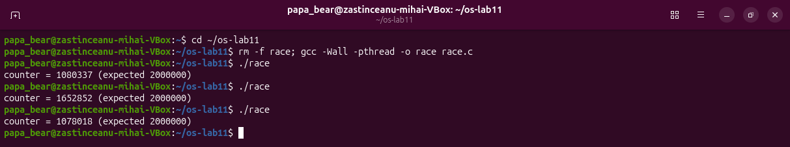
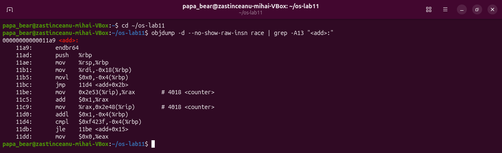
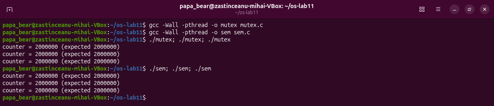
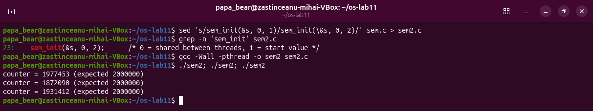
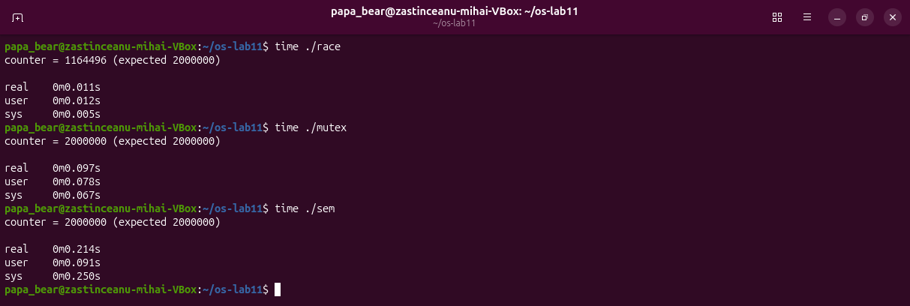
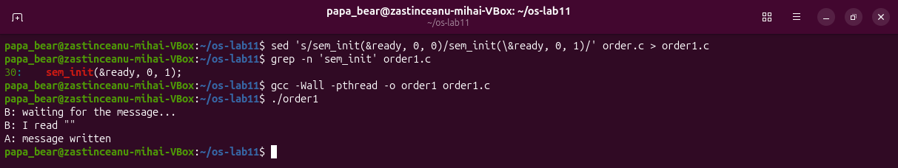
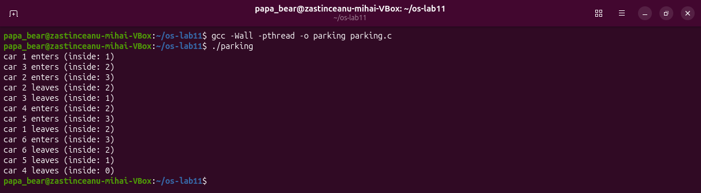
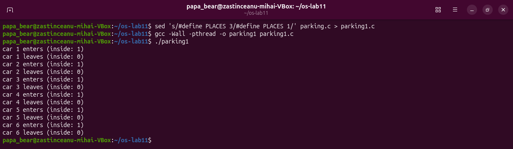
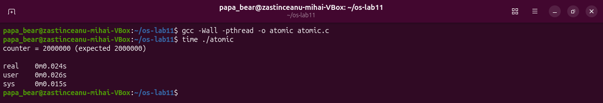

# Lab 11 – The Race and the Semaphore (Linux)

Zastinceanu Mihai, FAF-243. The complete report is also available as the .docx file.

## AIM OF THE WORK

### Purpose of the practical work

The purpose of the work is to see a race condition between two threads that change the same variable, to remove it with a mutex and with a semaphore, and to use the same semaphore in three ways: as a lock, as a signal and as a counter [1]. The work was done on the course virtual machine (Ubuntu 26.04.1 LTS, Linux 7.0.0-42-generic, 4 virtual processors) with gcc 15.2.0 and glibc 2.43; every program was compiled with gcc -Wall -pthread, without -O2, and without warnings.

### Problem statement

The following tasks have to be solved:

- to run race.c, in which two threads add 1 to the same counter one million times each, and to explain why the result is wrong and different at every run
- to protect the counter with a mutex (mutex.c) and with a semaphore that starts at 1 (sem.c), to compare the speed and to try a semaphore that starts at 2
- to make one thread wait for another with a semaphore that starts at 0 (order.c)
- to limit six cars to three parking places with a semaphore that starts at 3 (parking.c)
- the optional part: to replace the lock with an atomic operation (atomic.c)

## 1 SEE THE RACE

### 1.1 Theoretical background

A thread is a flow of execution inside a process: all the threads of a process have their own stack and registers, but they share the global variables, the heap and the open files [2]. The functions pthread_create and pthread_join of the POSIX thread library start a thread that runs a given function and wait for it to finish. A race condition appears when the result depends on the order in which the threads happen to run; the piece of code that touches the shared data is the critical section, and only one thread may be inside it at a time [3].

### 1.2 Work performed

The program race.c (Listing 1.1) was compiled and run three times (Figure 1.1). The answer was never 2 000 000: the three runs gave 1 080 337, 1 652 852 and 1 078 018, so between 17 % and 46 % of the additions were lost, and a fourth run under time gave 1 164 496.

```
/* race.c - two threads add to the same counter, with no protection.
 * Build: gcc -Wall -pthread -o race race.c   (no -O2: keep counter++ in memory)
 * Run:   ./race   (several times)
 */
#include <stdio.h>
#include <pthread.h>

#define N 1000000

long counter = 0;                  /* shared by both threads */

void *add(void *arg) {
    for (int i = 0; i < N; i++)
        counter++;                 /* read, add 1, write back: three steps */
    return NULL;
}

int main(void) {
    pthread_t a, b;
    pthread_create(&a, NULL, add, NULL);
    pthread_create(&b, NULL, add, NULL);
    pthread_join(a, NULL);
    pthread_join(b, NULL);
    printf("counter = %ld (expected %d)\n", counter, 2 * N);
    return 0;
}
```

*Listing 1.1 – The program race.c*



*Figure 1.1 – Three runs of race: the counter never reaches 2 000 000*

To see the real steps of counter++, the function add was disassembled with objdump (Figure 1.2). The body of the loop contains exactly three instructions for counter++: mov 0x2e53(%rip),%rax loads the counter from memory into the register rax, add $0x1,%rax adds 1 in the register, and mov %rax,0x2e48(%rip) writes the register back into the counter.



*Figure 1.2 – The three machine instructions of counter++ in the function add*

### 1.3 Answers to the questions

Question 1. counter++ is done by the CPU in three steps: load the value of counter from memory into a register, add 1 to the register, store the register back into counter (mov, add, mov in Figure 1.2).

Question 2. Suppose counter = 5. Thread A loads 5 into its register; before A stores, thread B (on another core, or after a context switch) also loads 5. A adds 1 and stores 6, B adds 1 and also stores 6. Two additions were made, but the counter grew only by 1: the addition of A was overwritten by B, so it is lost.

Question 3. The result depends on how the steps of the two threads interleave, and this depends on timing that the program does not control: on which cores the threads run, when the scheduler interrupts them, what else the machine is doing, cache effects. This timing is different at every run, so the number of overlaps, and the number of lost additions, is different every time.

## 2 FIX IT: MUTEX, THEN SEMAPHORE

### 2.1 Theoretical background

A mutex (mutual exclusion lock) has two operations: pthread_mutex_lock takes the lock, or waits while another thread holds it, and pthread_mutex_unlock releases it; the code between them is executed by only one thread at a time [4]. A semaphore is a counter that never goes below 0, with two operations defined by Dijkstra: sem_wait (P, down) takes one unit and blocks while the value is 0, and sem_post (V, up) gives one unit back and wakes a waiting thread [5]. A semaphore that starts at 1 lets only one thread pass, so it behaves like a mutex; sem_init(&s, 0, value) creates it, the 0 meaning that it is shared between the threads of one process [6].

### 2.2 Work performed

The programs mutex.c and sem.c differ from race.c only in the loop (Listing 2.1). Both were compiled and run three times, and all six runs printed exactly 2 000 000 (Figure 2.1).

```
/* mutex.c */
for (int i = 0; i < N; i++) {
    pthread_mutex_lock(&lock);     /* only one thread past this line */
    counter++;                     /* the critical section */
    pthread_mutex_unlock(&lock);   /* let the other one in */
}

/* sem.c, with sem_init(&s, 0, 1) in main */
for (int i = 0; i < N; i++) {
    sem_wait(&s);                  /* 1 -> 0: I go in; at 0: wait */
    counter++;
    sem_post(&s);                  /* 0 -> 1: the next one may go in */
}
```

*Listing 2.1 – The loop of mutex.c and of sem.c*



*Figure 2.1 – mutex and sem: always 2 000 000*

Then a copy of sem.c, sem2.c, was made with sed, with the start value 2 instead of 1 (Figure 2.2). The three runs gave 1 977 453, 1 872 090 and 1 931 412: the result is wrong again, although fewer additions are lost than without any lock.



*Figure 2.2 – sem2.c: the same program with sem_init(&s, 0, 2)*

Finally the three programs were timed (Figure 2.3): race took 0.011 s (and was wrong), mutex 0.097 s and sem 0.214 s. The order is the same as on the reference machine: no lock, then the mutex, then the semaphore. The semaphore also spent 0.250 s in the kernel (sys), more than its real time, because both threads went into the kernel many times to sleep and to be woken up.



*Figure 2.3 – The price of the lock: time ./race, ./mutex and ./sem*

### 2.3 Answers to the questions

Question 1. Yes. mutex and sem were run three times each and every run printed counter = 2000000 (expected 2000000), because counter++ is now a critical section that only one thread executes at a time.

Question 2. With sem_init(&s, 0, 2) the semaphore lets two threads pass sem_wait at the same time: the first one changes the value from 2 to 1, the second one from 1 to 0, and both are inside the critical section together. Since there are only two threads, the semaphore never blocks anybody and the protection disappears, so the race comes back: the results were 1 977 453, 1 872 090 and 1 931 412. A semaphore that starts at N lets N threads in, so only the start value 1 gives mutual exclusion.

Question 3. The locked version does more work for every addition: besides the three instructions of counter++, each iteration executes the lock and the unlock, which are atomic read-modify-write instructions on a shared variable, and the cache line of the lock moves between the two cores all the time. When the lock is taken, the other thread cannot continue: it spins or calls the kernel (the futex system call) to sleep and later to be woken up, which costs a system call and a context switch. In addition, the two threads no longer work in parallel inside the loop: they take turns. The semaphore was even slower than the mutex, because its sem_post must also check for and wake sleeping threads; this is the time spent in the kernel (sys 0.250 s).

## 3 A SEMAPHORE AS A SIGNAL

### 3.1 Theoretical background

A semaphore can also order events between threads. If it starts at 0, the first sem_wait blocks until another thread calls sem_post, so the thread that waits is sure that the work done before the sem_post is finished; the semaphore "remembers" the post, so the order of the calls does not matter: a post made before the wait is not lost [5].

### 3.2 Work performed

The program order.c (Listing 3.1) starts the reader B first, on purpose. B printed its first line at once, then nothing happened for one second, and only after A wrote the message did B read "hello" (Figure 3.1).

```
char message[32];             /* starts at 0: nothing is ready yet */
sem_t ready;                  /* sem_init(&ready, 0, 0) in main */

void *writer(void *arg) {
    sleep(1);                 /* pretend the work takes a while */
    strcpy(message, "hello");
    printf("A: message written\n");
    sem_post(&ready);         /* 0 -> 1: wake up B */
    return NULL;
}

void *reader(void *arg) {
    printf("B: waiting for the message...\n");
    sem_wait(&ready);         /* blocks while the value is 0 */
    printf("B: I read \"%s\"\n", message);
    return NULL;
}
```

*Listing 3.1 – The two threads of order.c*


*Figure 3.1 – order: B waits until A has written the message*

The copy order1.c, with sem_init(&ready, 0, 1), was then compiled and run (Figure 3.2): B printed B: I read "" immediately, and only one second later A printed A: message written.



*Figure 3.2 – order1.c: with the start value 1 the reader does not wait*

### 3.3 Answers to the questions

Question 1. With the start value 1, B reads an empty string: B: I read "". The semaphore already has one unit, so sem_wait in B takes it (1 -> 0) and returns at once, without waiting for A. At that moment A is still in sleep(1), and message is a global array filled with zeros, so B prints the empty string; A writes "hello" only one second later, when nobody reads it any more.

Question 2. A semaphore that starts at 0 means "the event has not happened yet": whoever calls sem_wait blocks until another thread signals the event with sem_post.

## 4 A SEMAPHORE AS A COUNTER: THE PARKING LOT

### 4.1 Theoretical background

A counting semaphore that starts at N represents N identical resources: every sem_wait takes one of them and every sem_post returns one, so at most N threads can hold a resource at the same time and the others wait in sem_wait [3]. With N = 1 it becomes a binary semaphore, which is a lock.

### 4.2 Work performed

In parking.c (Listing 4.1), the semaphore places starts at 3 and six cars (threads) each park for one second. The mutex protects only the variable inside and the printf, so that the printed numbers are consistent. The run (Figure 4.1) shows three cars entering at once, then every new car entering only after one has left; inside was never greater than 3.

```
sem_t places;               /* sem_init(&places, 0, PLACES), PLACES = 3 */

void *car(void *arg) {
    long id = (long)arg;
    sem_wait(&places);                 /* take a place, or wait */
    pthread_mutex_lock(&lock);
    inside++;
    printf("car %ld enters (inside: %d)\n", id, inside);
    pthread_mutex_unlock(&lock);
    sleep(1);                          /* parked */
    pthread_mutex_lock(&lock);
    inside--;
    printf("car %ld leaves (inside: %d)\n", id, inside);
    pthread_mutex_unlock(&lock);
    sem_post(&places);                 /* give the place back */
    return NULL;
}
```

*Listing 4.1 – The function car of parking.c*



*Figure 4.1 – parking: six cars, three places*

With PLACES set to 1 (parking1.c, Figure 4.2), the cars entered strictly one by one: every "enters (inside: 1)" is followed by "leaves (inside: 0)" of the same car, and the program ran about six seconds instead of two.



*Figure 4.2 – parking1.c: with one place the semaphore becomes a lock*

### 4.3 Answers to the questions

Question 1. The largest value of inside is 3 (cars 2, 5 and 6 in Figure 4.1 each entered with inside: 3). The line that guarantees it is sem_wait(&places); at the beginning of car(): the semaphore starts at 3, so only three cars can pass it, and the fourth one blocks there until a car that leaves calls sem_post(&places).

Question 2. With PLACES = 1 the semaphore can only be 0 or 1: it becomes a binary semaphore, that is, a lock (a mutex) around the parking. Only one car is inside at any time, and the cars park one after another.

## 5 OPTIONAL: NO LOCK AT ALL

### 5.1 Theoretical background

For a single counter there is a third way: an atomic operation. The C11 header stdatomic.h provides types such as atomic_long and functions such as atomic_fetch_add, which the compiler translates into one indivisible instruction of the CPU (on x86-64 an instruction with the lock prefix, such as lock add or lock xadd), so no other core can modify the variable between the load and the store [7].

### 5.2 Work performed

The program atomic.c is race.c with atomic_long counter and atomic_fetch_add(&counter, 1) instead of counter++. It printed 2 000 000 in 0.024 s (Figure 5.1), about four times faster than the mutex (0.097 s) and close to the reference value of 0.03 s: there is no lock to take and no thread ever sleeps.



*Figure 5.1 – atomic: correct and faster than the mutex*

## CONCLUSIONS

The experiment with race.c showed that a single line of C, counter++, is three machine instructions, and that two threads which interleave them lose up to half of the additions, with a different result at every run; such an error is dangerous precisely because it depends on timing and does not appear in every test.

The same tool, the semaphore, solved three different problems depending only on its start value: with 1 it was a lock that gave the correct 2 000 000, with 0 it was a signal that forced the reader to wait for the writer, and with 3 it was a counter that never let more than three cars into the parking. The wrong start values (2 for the lock, 1 for the signal) broke the programs in the expected way. Correctness has a price: the mutex was about nine times slower than the unprotected loop and the semaphore about twenty times, while an atomic instruction gave the correct result for one counter at a fraction of that cost.

## REFERENCES

1. The Race and the Semaphore. Laboratory Work 11, Operating Systems course. FCIM, Technical University of Moldova, 2026.
2. DUMITRACU, M. Session 6: Semaphores and Synchronization Tools. Operating Systems course, FCIM, UTM, 2026.
3. ARPACI-DUSSEAU, R. H., ARPACI-DUSSEAU, A. C. Operating Systems: Three Easy Pieces, chapters 26-31 (Concurrency, Locks, Semaphores) [online]. Arpaci-Dusseau Books, 2023. Available: https://pages.cs.wisc.edu/~remzi/OSTEP/
4. pthread_mutex_lock(3p) – POSIX Programmer's Manual [online]. Available: https://man7.org/linux/man-pages/man3/pthread_mutex_lock.3p.html
5. sem_overview(7) – Linux manual page [online]. Available: https://man7.org/linux/man-pages/man7/sem_overview.7.html
6. sem_init(3) – Linux manual page [online]. Available: https://man7.org/linux/man-pages/man3/sem_init.3.html
7. Atomic operations library – cppreference.com [online]. Available: https://en.cppreference.com/w/c/atomic
