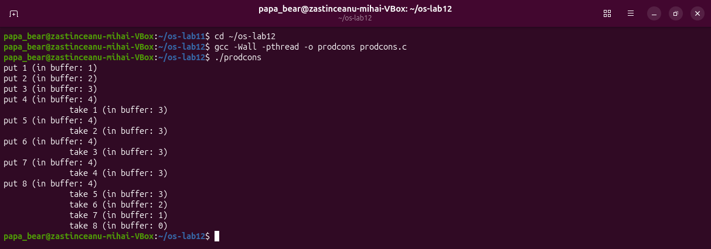
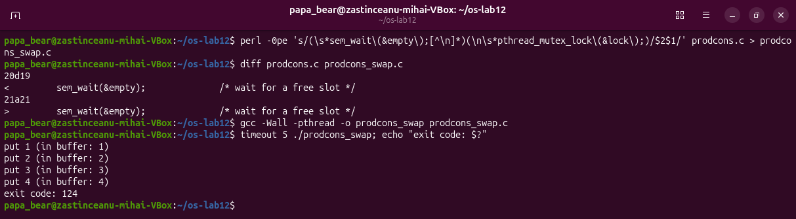
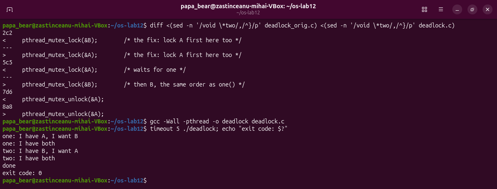
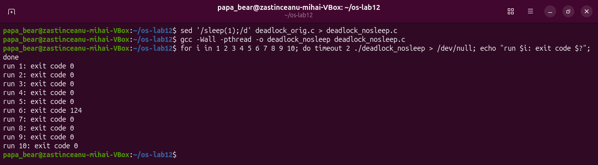

# Lab 12 – Producer, Consumer and the Other Tools (Linux)

Zastinceanu Mihai, FAF-243. The complete report is also available as the .docx file.

## AIM OF THE WORK

### Purpose of the practical work

The purpose of the work is to make the synchronization tools of Lab 11 work together: to solve the two classic problems of concurrency, producer and consumer and readers and writers, to use a condition variable, and to build a deadlock and then remove it [1]. The work was done on the course virtual machine (Ubuntu 26.04.1 LTS, Linux 7.0.0-42-generic, 4 virtual processors) with gcc 15.2.0 and glibc 2.43; all programs were compiled with gcc -Wall -pthread without warnings.

### Problem statement

The following tasks have to be solved:

- to run a producer and a slow consumer around a buffer of 4 slots, synchronized with two semaphores and a mutex (prodcons.c), and to see what happens when the mutex is taken before sem_wait
- to solve the problem of order.c from Lab 11 with a mutex and a condition variable (condvar.c), with while and with if
- to let several readers read together while a writer is always alone (readers.c)
- to build a deadlock with two mutexes taken in opposite order (deadlock.c), to fix it, and to see how it behaves without the sleep calls

## 1 PRODUCER AND CONSUMER

### 1.1 Theoretical background

In the producer–consumer (bounded buffer) problem one thread puts items into a buffer of fixed size and another one takes them out; the producer must wait when the buffer is full and the consumer when it is empty [2]. The classic solution uses three tools: a semaphore empty that counts the free slots (it starts at the size of the buffer), a semaphore full that counts the filled slots (it starts at 0) and a mutex that protects the buffer and its indexes in and out. A pipe of Unix works exactly like this inside the kernel: write blocks when the pipe buffer is full and read blocks when it is empty [3].

### 1.2 Work performed

The program prodcons.c (Listing 1.1) puts 8 items into a buffer of 4 slots; the consumer sleeps 0.3 s after every item. The run (Figure 1.1) is the expected one: the producer filled the buffer at once (put 1 to put 4, in buffer: 4), then it could put a new item only after the consumer had taken one, so put and take alternated and the buffer stayed between 3 and 4; at the end the consumer emptied it (take 5 to take 8).

```
void *producer(void *arg) {
    for (int item = 1; item <= ITEMS; item++) {
        sem_wait(&empty);              /* wait for a free slot */
        pthread_mutex_lock(&lock);
        buf[in] = item;
        in = (in + 1) % SIZE;
        count++;
        printf("put %d (in buffer: %d)\n", item, count);
        pthread_mutex_unlock(&lock);
        sem_post(&full);               /* one more filled slot */
    }
    return NULL;
}

void *consumer(void *arg) {
    for (int k = 0; k < ITEMS; k++) {
        sem_wait(&full);               /* wait for something to take */
        pthread_mutex_lock(&lock);
        int item = buf[out];
        out = (out + 1) % SIZE;
        count--;
        printf("              take %d (in buffer: %d)\n", item, count);
        pthread_mutex_unlock(&lock);
        sem_post(&empty);              /* one more free slot */
        usleep(300000);                /* the consumer is slow */
    }
    return NULL;
}
/* main: sem_init(&empty, 0, SIZE); sem_init(&full, 0, 0); */
```

*Listing 1.1 – The producer and the consumer of prodcons.c*



*Figure 1.1 – prodcons: the buffer never holds more than 4 items*

For question 3, a copy prodcons_swap.c was made with perl, in which the producer locks the mutex before sem_wait(&empty); diff shows the only change (Figure 1.2). Run under timeout 5, it printed put 1 to put 4 and then nothing at all, until timeout killed it (exit code 124). The consumer never printed a single take.



*Figure 1.2 – prodcons_swap: the mutex taken before sem_wait(&empty) blocks both threads*

### 1.3 Answers to the questions

Question 1. The call sem_wait(&empty) in producer() stops it. empty starts at 4 and every put decreases it, so after four puts it is 0 and the producer sleeps in sem_wait(&empty) until the consumer frees a slot with sem_post(&empty).

Question 2. At the start the consumer waits. It is created first, but full starts at 0, so its call sem_wait(&full) blocks until the producer puts the first item and calls sem_post(&full).

Question 3. When the buffer is full, the program hangs forever (deadlock). The producer now takes the mutex first and then calls sem_wait(&empty); with a full buffer empty is 0, so the producer sleeps while it still holds the mutex. The consumer, to take an item and free a slot, must first lock the same mutex, so it blocks in pthread_mutex_lock. The producer waits for the consumer (a free slot) and the consumer waits for the producer (the mutex): neither can continue. In our run this happened already after put 4: the producer was so fast that it re-locked the mutex after each unlock before the consumer could take it, so the consumer never got in. The rule is: wait on the semaphore first, and take the mutex only for the short moment when the buffer is changed.

## 2 THE CONDITION VARIABLE

### 2.1 Theoretical background

A condition variable is a place where a thread sleeps until another thread tells it that "something changed" [4]. It has no memory of its own: the state is a normal variable protected by a mutex. pthread_cond_wait(&cv, &m) must be called with the mutex held; it releases the mutex and puts the thread to sleep in one atomic step, and takes the mutex again before it returns. pthread_cond_signal wakes one waiting thread and pthread_cond_broadcast wakes all of them. Because a woken thread may find the condition false again, and because POSIX allows spurious wakeups, the condition must always be tested in a while loop [5].

### 2.2 Work performed

The program condvar.c (Listing 2.1) was compiled and run (Figure 2.1): B found ready == 0, printed B: not ready, I sleep and slept in pthread_cond_wait; after one second A wrote the message, set ready = 1 and signalled, and B woke up and read "hello". The variant condvar_if.c, made with sed (while replaced by if), printed exactly the same three lines.

```
char message[32];
int ready = 0;                                   /* the condition itself */
pthread_mutex_t lock = PTHREAD_MUTEX_INITIALIZER;
pthread_cond_t changed = PTHREAD_COND_INITIALIZER;

void *writer(void *arg) {
    sleep(1);
    pthread_mutex_lock(&lock);
    strcpy(message, "hello");
    ready = 1;
    printf("A: message written\n");
    pthread_cond_signal(&changed);               /* wake one waiter */
    pthread_mutex_unlock(&lock);
    return NULL;
}

void *reader(void *arg) {
    pthread_mutex_lock(&lock);
    while (!ready) {               /* while, not if: re-check after waking */
        printf("B: not ready, I sleep\n");
        pthread_cond_wait(&changed, &lock); /* unlocks, sleeps, locks again */
    }
    printf("B: I read \"%s\"\n", message);
    pthread_mutex_unlock(&lock);
    return NULL;
}
```

*Listing 2.1 – The writer and the reader of condvar.c*


*Figure 2.1 – condvar with while and condvar_if with if*

### 2.3 Answers to the questions

Question 1. In order.c the value of the semaphore itself remembered that the message was ready. Here the variable ready remembers it (ready = 1, written under the mutex); the condition variable changed remembers nothing, it is only the place where B sleeps.

Question 2. Yes, here it still works (Figure 2.1): there is only one waiter and only one signal, which is sent after ready = 1, so when B wakes up ready is really 1.

Question 3. Because waking up does not guarantee that the condition is true. Reasons: POSIX allows spurious wakeups, so pthread_cond_wait may return although nobody signalled; with several waiters, pthread_cond_broadcast (or a signal) wakes them all, but another thread may get the mutex first and consume the change (for example take the only message and set ready back to 0) before the woken thread runs; and a thread may also be woken by a signal sent for a different condition that uses the same condition variable. With while the thread checks again and goes back to sleep if ready is still 0; with if it would continue with a false condition.

## 3 READERS AND WRITERS

### 3.1 Theoretical background

In the readers–writers problem, many threads may read the shared data at the same time, because reading changes nothing, but a writer must be alone, without other writers or readers [2]. The solution of Courtois, Heymans and Parnas uses a counter of the readers inside, protected by its own lock, and a semaphore room: the first reader that enters locks the room against the writers and the last reader that leaves unlocks it [6]. This solution favours the readers.

### 3.2 Work performed

The program readers.c (Listing 3.1) starts writer 1, three readers and writer 2. Two runs gave the expected behaviour (Figure 3.1): writer 1 wrote 10 alone, then the three readers were inside together (readers inside: 1, 2, 3, in a different order in the two runs), and only after all of them had left did writer 2 write 20, alone.

```
void *reader(void *arg) {
    long id = (long)arg;
    sem_wait(&rlock);
    if (++readers == 1)    /* the first reader in locks out the writers */
        sem_wait(&room);
    sem_post(&rlock);

    printf("reader %ld reads %d (readers inside: %d)\n", id, value, readers);
    usleep(200000);

    sem_wait(&rlock);
    if (--readers == 0)    /* the last reader out lets the writers in */
        sem_post(&room);
    sem_post(&rlock);
    return NULL;
}

void *writer(void *arg) {
    long id = (long)arg;
    sem_wait(&room);             /* alone in the room */
    value += 10;
    printf("writer %ld writes %d (alone)\n", id, value);
    usleep(200000);
    sem_post(&room);
    return NULL;
}
```

*Listing 3.1 – The reader and the writer of readers.c*


*Figure 3.1 – readers: three readers together, every writer alone*

### 3.3 Answers to the questions

Question 1. The two lines are if (++readers == 1) sem_wait(&room); and if (--readers == 0) sem_post(&room);. Only the first reader that enters takes the room (the other readers find readers > 1 and go in without waiting for the room), and only the last reader that leaves gives the room back. While at least one reader is inside, the room stays taken, so a writer waits in its sem_wait(&room); and a writer that holds the room blocks the first reader, and therefore all the readers.

Question 2. readers++ and readers-- are read-modify-write operations like counter++ in Lab 11, so without rlock they can race. Two readers that enter together could both read 0 and both write 1: both believe they are the first and both call sem_wait(&room), so the second one blocks although a reader is already inside. On exit, two readers could both see readers == 0 and call sem_post(&room) twice, making room 2, so two writers could then enter together; or a lost decrement could leave readers > 0 forever, so the room is never given back and the writers starve forever. rlock makes the change of the counter and the test of its value one indivisible step.

Question 3. Writer 2 may wait forever. The room is released only when the counter drops to 0, but if new readers keep arriving before the last one leaves, there is always at least one reader inside: the newcomers enter without waiting for the room, while the writer stays blocked in sem_wait(&room). This is starvation: the writer is not deadlocked, the system makes progress, but this thread never gets its turn. The usual fix is a "turnstile" semaphore that new readers must also pass, so that a waiting writer stops new readers from entering.

## 4 BUILD A DEADLOCK, THEN REMOVE IT

### 4.1 Theoretical background

A deadlock is a state in which every thread of a set waits for a resource held by another thread of the same set, so none of them can continue. It can appear only if four conditions hold together (Coffman): mutual exclusion, hold and wait, no preemption and circular wait [7]. Breaking any one of them prevents the deadlock; the simplest method in practice is to break the circular wait by taking the locks always in the same global order.

### 4.2 Work performed

The original deadlock.c (kept in the virtual machine as deadlock_orig.c) was run under timeout 5 (Figure 4.1). It printed one: I have A, I want B and two: I have B, I want A, then nothing for five seconds, and timeout killed it with the exit code 124.


*Figure 4.1 – The original deadlock.c: both threads wait forever*

The fix was made in two(): the two pthread_mutex_lock lines and the two unlock lines were swapped, so two() takes A first and then B, like one() (Listing 4.1; the printed texts were kept as in the handout). The fixed program printed the expected five lines and exited with the code 0 (Figure 4.2): two waited at the lock of A until one had finished with both mutexes.

```
void *two(void *arg) {
    pthread_mutex_lock(&A);        /* the fix: lock A first here too */
    printf("two: I have B, I want A\n");
    sleep(1);
    pthread_mutex_lock(&B);        /* then B, the same order as one() */
    printf("two: I have both\n");
    pthread_mutex_unlock(&B);
    pthread_mutex_unlock(&A);
    return NULL;
}
```

*Listing 4.1 – The function two() in the fixed deadlock.c*



*Figure 4.2 – The fix: the same order of locks in both threads, exit code 0*

Finally both sleep(1) lines were deleted from the original version with sed (deadlock_nosleep.c) and the program was run ten times with timeout 2 (Figure 4.3): nine runs finished with exit code 0 and one (run 6) hung and was killed (124). To get a better estimate, 200 more runs were made with timeout 5: 4 of them hung, that is about 2 %.



*Figure 4.3 – The original version without sleep: it hangs only sometimes*

### 4.3 Answers to the questions

Question 1. In the stuck run thread one holds mutex A and waits for mutex B, while thread two holds mutex B and waits for mutex A. The circle is:

```
        holds            waits for
  one ---------> A <----------------- two
   |                                   ^
   | waits for                   holds |
   +----------------> B ---------------+

  one holds A, wants B (held by two); two holds B, wants A (held by one)
```

Question 2. No. Without sleep(1) the first thread usually takes both mutexes and releases them before the second thread even starts, so most runs finish: 9 out of 10 in Figure 4.3 and 196 out of 200 in the longer test. It still hangs sometimes, when the two threads happen to take their first mutex at the same moment. This is worse, not better: the bug is still there, but it becomes rare and random, so it passes the tests and appears later, in production, under a different load or on a different machine, and it is very hard to reproduce and to debug. The sleep made the bug appear every time, which is the best situation for finding it.

Question 3. If all threads take the locks in the same order (first A, then B), a thread that holds B has already taken A, so nobody can hold B while waiting for A: the circular wait, one of the four necessary conditions of a deadlock, can never form.

## CONCLUSIONS

The producer–consumer program showed how the three tools work together: two counting semaphores block the producer on a full buffer and the consumer on an empty one, and a mutex protects only the short change of the buffer. Swapping two lines, so that the mutex was held while waiting on a semaphore, turned the correct program into a deadlock, which shows that the order of the synchronization calls matters as much as the calls themselves.

The condition variable solved the problem of order.c in another way: the state is kept in a normal variable, and the condition variable is only the place to sleep, which is why the condition is checked in a while loop. The readers–writers solution allowed three readers inside at the same time but always kept the writer alone, at the price of possible starvation of the writers. The deadlock experiment showed the circular wait of two threads and its simple remedy, a common order of the locks; without the sleep calls the deadlock appeared only in about 2 % of the runs, which illustrates why such bugs are so hard to find by testing.

## REFERENCES

1. Producer, Consumer and the Other Tools. Laboratory Work 12, Operating Systems course. FCIM, Technical University of Moldova, 2026.
2. ARPACI-DUSSEAU, R. H., ARPACI-DUSSEAU, A. C. Operating Systems: Three Easy Pieces, chapters 30-32 (Condition Variables, Semaphores, Common Concurrency Problems) [online]. Arpaci-Dusseau Books, 2023. Available: https://pages.cs.wisc.edu/~remzi/OSTEP/
3. pipe(7) – Linux manual page [online]. Available: https://man7.org/linux/man-pages/man7/pipe.7.html
4. DUMITRACU, M. Session 6: Semaphores and Synchronization Tools. Operating Systems course, FCIM, UTM, 2026.
5. pthread_cond_wait(3p) – POSIX Programmer's Manual [online]. Available: https://man7.org/linux/man-pages/man3/pthread_cond_wait.3p.html
6. COURTOIS, P. J., HEYMANS, F., PARNAS, D. L. Concurrent control with "readers" and "writers". Communications of the ACM, 1971, vol. 14, no. 10, pp. 667-668.
7. SILBERSCHATZ, A., GALVIN, P. B., GAGNE, G. Operating System Concepts, 10th edition, chapter 8 (Deadlocks). Wiley, 2018.
