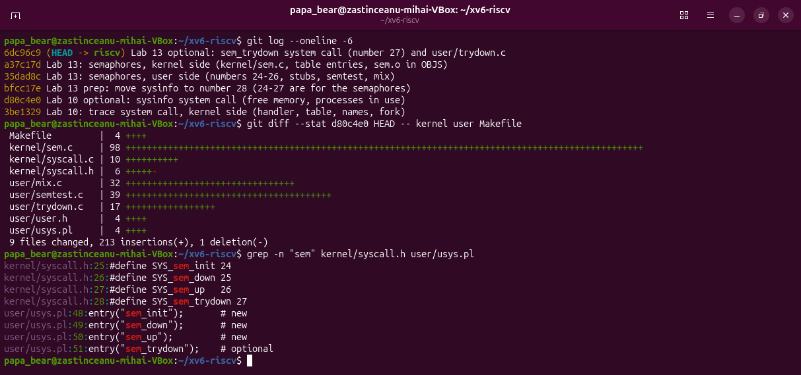
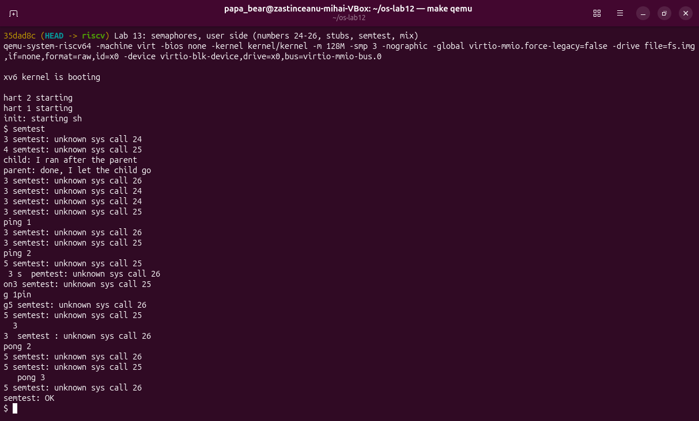
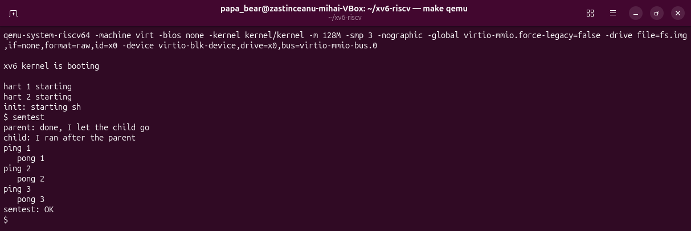
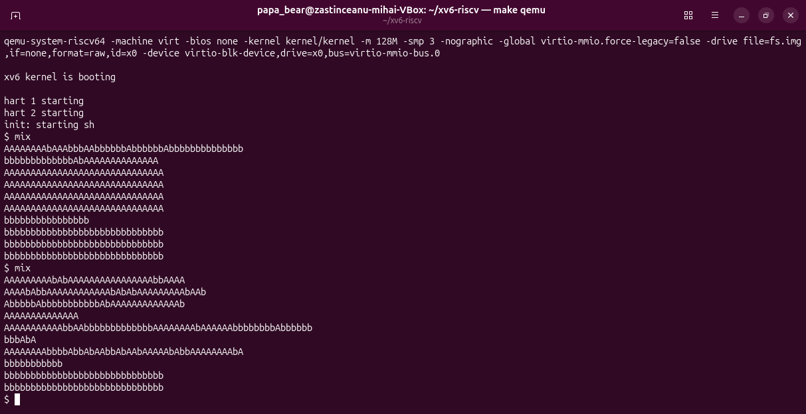
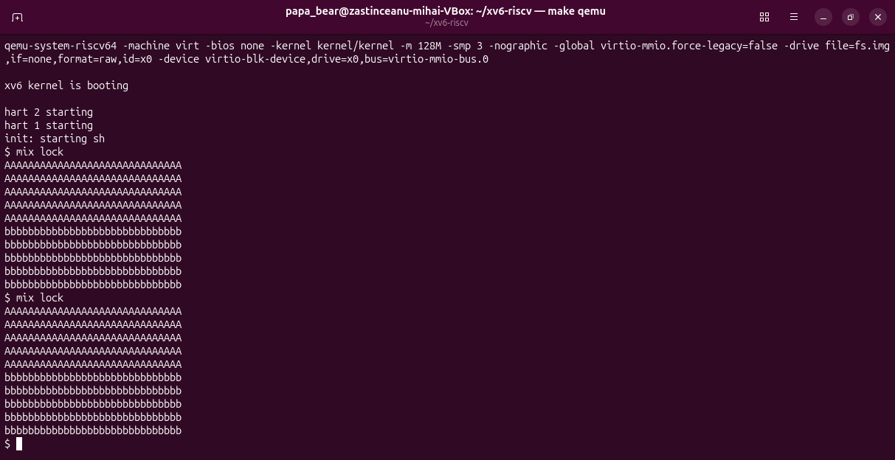
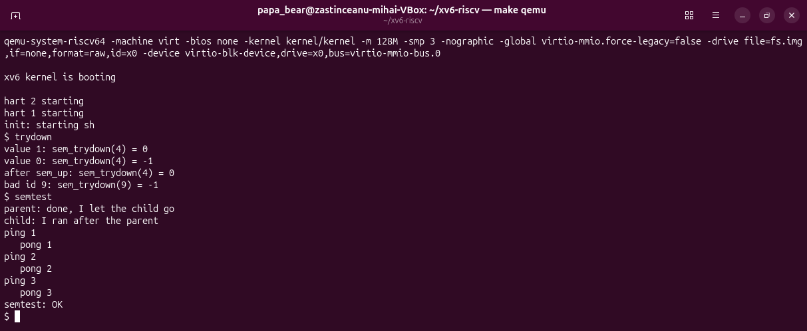

# Lab 13 – Semaphores in Your Own Kernel (xv6)

Zastinceanu Mihai, FAF-243. The complete report is also available as the .docx file; the short Observe answers required by the handout are in notes.txt.

## AIM OF THE WORK

### Purpose of the practical work

The purpose of the work is to build counting semaphores inside the xv6 kernel as three new system calls, sem_init, sem_down and sem_up, with the numbers 24, 25 and 26, and to see that a semaphore is only a number, a spinlock that protects it, and the sleep and wakeup of the kernel [1]. The work was done in the tree ~/xv6-riscv of the course virtual machine (Ubuntu 26.04.1 LTS), on the branch riscv that already contains trace from Lab 10, built with riscv64-linux-gnu-gcc 15.2.0 and run in QEMU 10.2.1 with 3 CPUs.

### Problem statement

The following tasks have to be solved:

- to give the new calls the numbers 24, 25 and 26 and to write the user side: declarations, stubs, the test programs semtest and mix, the Makefile (Check 1)
- to write the kernel side: the table of semaphores in kernel/sem.c, sem.o in the kernel, the entries in the table of system calls (Check 2: semtest prints semtest: OK)
- to use a semaphore as a lock in mix and to answer the questions about the implementation
- the optional part: a fourth call, sem_trydown (number 27), that never sleeps, with a small test program

## 1 THE NUMBERS AND THE USER SIDE

### 1.1 Theoretical background

A system call of xv6 is identified by a number: the stub generated by user/usys.pl puts the number into the register a7 and executes ecall, and the function syscall() of the kernel uses it as an index into the table syscalls[] [2]. If the table has no entry for the number, syscall() prints "pid name: unknown sys call N" and returns -1 to the program. Adding a call therefore needs the same recipe as trace in Lab 10: the number in kernel/syscall.h, the declaration in user/user.h, the stub in user/usys.pl and, in the kernel, the handler and the table entry.

### 1.2 Work performed

In our tree the number 24 was already used by the optional call sysinfo of Lab 10. To keep the numbers required by the handout, sysinfo was first moved to 28 in a separate commit (the stub refers to SYS_sysinfo by name, so nothing else had to change). Then the user side was added: #define SYS_sem_init 24, SYS_sem_down 25 and SYS_sem_up 26 in kernel/syscall.h, the declarations int sem_init(int, int), int sem_down(int) and int sem_up(int) in user/user.h, the three entry lines in user/usys.pl, the programs user/semtest.c (Listing 1.1) and user/mix.c from the handout, and $U/_semtest and $U/_mix in UPROGS after $U/_zombie. The work was committed in four commits (Figure 1.1).

```
// semtest.c: two tests for the kernel semaphores (Lab 13).
#include "kernel/types.h"
#include "user/user.h"

int
main(void)
{
  // Test 1: order. Semaphore 0 starts at 0, so the child must wait.
  sem_init(0, 0);
  if (fork() == 0) {
    sem_down(0);
    printf("child: I ran after the parent\n");
    exit(0);
  }
  pause(10);
  printf("parent: done, I let the child go\n");
  sem_up(0);
  wait(0);

  // Test 2: ping-pong. Semaphore 1 = ping's turn, semaphore 2 = pong's turn.
  sem_init(1, 1);
  sem_init(2, 0);
  if (fork() == 0) {
    for (int i = 1; i <= 3; i++) {
      sem_down(2);
      printf("   pong %d\n", i);
      sem_up(1);
    }
    exit(0);
  }
  for (int i = 1; i <= 3; i++) {
    sem_down(1);
    printf("ping %d\n", i);
    sem_up(2);
  }
  wait(0);
  printf("semtest: OK\n");
  exit(0);
}
```

*Listing 1.1 – The program user/semtest.c*



*Figure 1.1 – The commits of the work, the changed files and the new numbers*

For Check 1, xv6 was started with make qemu at the commit with the user side only, and semtest was run (Figure 1.2). The first lines are exactly the expected ones: 3 semtest: unknown sys call 24, 4 semtest: unknown sys call 25, then child: I ran after the parent before parent: done, I let the child go. The calls reach the kernel, which does not know them yet; sem_down returns -1 at once, so the child does not wait. After these lines ping and pong are mixed with the error lines.



*Figure 1.2 – Check 1: the calls 24, 25 and 26 reach the kernel, which does not know them*

## 2 THE KERNEL SIDE

### 2.1 Theoretical background

xv6 has two kinds of waiting. A spinlock (acquire, release) protects data for a short time: the CPU loops until the lock is free, with interrupts turned off, so a process must never sleep while it holds one [3]. For long waits the kernel uses sleep and wakeup on a channel, which is any address: the process marks itself SLEEPING and gives the CPU to the scheduler, and wakeup(chan) makes runnable all processes that sleep on that channel. In our version of xv6 sleep works in two steps: sleep_prepare(chan) registers the channel, and sleep() goes to sleep only if no wakeup on the channel came in between; this prevents the lost wakeup that would happen if sem_up ran after the lock was released but before the process was asleep. A sleeping process uses no CPU.

### 2.2 Work performed

The new file kernel/sem.c (Listing 2.1) contains a table of 8 semaphores shared by all processes, each with a spinlock and a value, and the three handlers. sem_down tests the value in a while loop: while it is 0, the process registers the address of the semaphore as its channel, releases the spinlock, sleeps, takes the spinlock again and checks whether it was killed. sem_up increases the value and wakes everyone who sleeps on the address of the semaphore. The file was added to OBJS in the Makefile ($K/sem.o after $K/sysproc.o), and the three functions to kernel/syscall.c (Listing 2.2), also with their names for trace.

```
#define NSEM 8

struct sem {
  struct spinlock lock;   // a zeroed spinlock is a free spinlock
  int value;              // how many may still pass
};

static struct sem sems[NSEM];

uint64
sys_sem_init(void)
{
  int id, value;
  argint(0, &id);
  argint(1, &value);
  if (id < 0 || id >= NSEM || value < 0)
    return -1;
  acquire(&sems[id].lock);
  sems[id].value = value;
  release(&sems[id].lock);
  return 0;
}

uint64
sys_sem_down(void)
{
  int id;
  argint(0, &id);
  if (id < 0 || id >= NSEM)
    return -1;
  struct sem *s = &sems[id];

  acquire(&s->lock);
  while (s->value == 0) {
    sleep_prepare(s);       // I will sleep on the address of s
    release(&s->lock);      // never sleep holding a spinlock
    sleep();                // returns at once if sem_up came in between
    acquire(&s->lock);
    if (killed(myproc())) { // kill must still work on a waiting process
      release(&s->lock);
      return -1;
    }
  }
  s->value--;
  release(&s->lock);
  return 0;
}

uint64
sys_sem_up(void)
{
  int id;
  argint(0, &id);
  if (id < 0 || id >= NSEM)
    return -1;
  struct sem *s = &sems[id];

  acquire(&s->lock);
  s->value++;
  wakeup(s);
  release(&s->lock);
  return 0;
}
```

*Listing 2.1 – The semaphores in kernel/sem.c*

```
extern uint64 sys_sem_init(void);   // new
extern uint64 sys_sem_down(void);   // new
extern uint64 sys_sem_up(void);     // new
...
  [SYS_sem_init] = sys_sem_init,
  [SYS_sem_down] = sys_sem_down,
  [SYS_sem_up]   = sys_sem_up,
```

*Listing 2.2 – The new entries in kernel/syscall.c*

The kernel was built without errors and Check 2 was run (Figure 2.1). The output is exactly the expected one: parent: done, I let the child go comes before child: I ran after the parent, although the parent waited 10 ticks before letting the child go, because the child was asleep in sem_down(0); then ping and pong alternated strictly three times, and the program printed semtest: OK.



*Figure 2.1 – Check 2: semtest with the kernel semaphores*

## 3 A SEMAPHORE AS A LOCK: MIX

### 3.1 Theoretical background

A semaphore that starts at 1 is a lock, as in Lab 11, but here it works between processes, not threads: the processes have separate memory, so the shared state must be in the kernel, which is where the table sems[] lives. The xv6 console writes the bytes of every write call to the UART, and nothing makes several calls of one process appear together [2].

### 3.2 Work performed

mix was run twice without a lock and twice with the lock (mix lock). Without the lock the letters were mixed in both runs, differently each time (Figure 3.1): in the first run the first two lines were mixed and most of the others came out whole by chance, in the second almost every line was mixed. With the lock (Figure 3.2) both runs printed five whole lines of A followed by five whole lines of b.



*Figure 3.1 – mix without the lock: the letters of the two processes mix*



*Figure 3.2 – mix lock: semaphore 3 keeps every line whole*

### 3.3 Answers to the questions

Question 1. mix writes one letter per write(), so one line of 30 letters plus the newline costs 31 system calls. Each call is a separate entry into the kernel, and between two of them the other process can write its own letters: make qemu starts xv6 with 3 CPUs, so the parent and the child really run at the same time on different harts, and a timer interrupt can also switch them. Nothing keeps the 31 calls of a line together, so the console receives the letters interleaved.

Question 2. The two lines are if (uselock) sem_down(3); before the loop of write calls and if (uselock) sem_up(3); after it. Semaphore 3 starts at 1 (sem_init(3, 1)), so sem_down lets only one process into the loop that writes a line, and the other one sleeps in the kernel until sem_up; the whole line is the critical section.

Question 3. sem_up adds only one unit, but wakeup(s) wakes all the processes that sleep on the address s. The first one that takes s->lock again takes the unit (1 -> 0), and the others, which get the lock after it, find 0 again and must go back to sleep. A process that was not sleeping at all can also call sem_down between the wakeup and the moment the woken process gets the lock, and take the unit first. In addition, sleep() returns at once if a wakeup came between sleep_prepare and sleep, and kill also makes a sleeping process runnable. Waking up means only "something changed", so the value must be tested again: while, not if.

Question 4. sem_up needs the same spinlock to increase the value and to call wakeup. If the process slept holding s->lock, the process that calls sem_up would spin forever in acquire(&s->lock), so the wakeup could never come: the sleeper waits for sem_up and sem_up waits for the lock of the sleeper, a deadlock. The spinning CPU also has its interrupts turned off (acquire calls push_off), so it is lost for all other work. In our xv6 it does not even get that far: sched() checks that the only lock held is p->lock (mycpu()->noff must be 1) and panics with "sched locks" when a process tries to sleep holding another spinlock.

## 4 OPTIONAL: SEM_TRYDOWN

### 4.1 Theoretical background

A non-blocking version of the down operation, like sem_trywait in POSIX, is useful when a process has other work to do and does not want to sleep: it takes a unit if there is one and otherwise reports failure at once [4].

### 4.2 Work performed

The fourth call sem_trydown received the number 27, with the same recipe: SYS_sem_trydown in kernel/syscall.h, the declaration in user/user.h, entry("sem_trydown") in user/usys.pl and the table entry in kernel/syscall.c. The handler (Listing 4.1) takes the spinlock and, if the value is 0, releases it and returns -1 immediately instead of sleeping. The program user/trydown.c starts semaphore 4 at 1 and calls sem_trydown three times. It printed (Figure 4.1) 0 when the value was 1, -1 when the value was 0 (without sleeping), 0 again after a sem_up, and -1 for the invalid id 9; semtest still printed semtest: OK.

```
uint64
sys_sem_trydown(void)
{
  int id;
  argint(0, &id);
  if (id < 0 || id >= NSEM)
    return -1;
  struct sem *s = &sems[id];

  acquire(&s->lock);
  if (s->value == 0) {
    release(&s->lock);
    return -1;
  }
  s->value--;
  release(&s->lock);
  return 0;
}
```

*Listing 4.1 – The handler sys_sem_trydown in kernel/sem.c*



*Figure 4.1 – trydown: both answers of sem_trydown, and semtest still correct*

## CONCLUSIONS

The semaphores of Labs 11 and 12 turned out to be very little code inside a kernel: a number, a spinlock that protects it, and the sleep and wakeup mechanism of the scheduler. Check 1 showed the calls reaching a kernel that did not know them, so the child ran before the parent; after kernel/sem.c was added, the child really slept in sem_down until the parent called sem_up, and ping and pong alternated strictly, which proves that the waiting processes were blocked by the kernel and used no CPU.

The work also made the two rules of the implementation concrete: the value must be tested in a while loop, because wakeup wakes every sleeper but only one can take the unit, and the spinlock must be released before sleeping, otherwise sem_up can never take it and the system deadlocks (xv6 even panics). With the same semaphore used as a lock between two processes, mix printed whole lines, while without it the 31 write calls of each line were interleaved by the 3 CPUs.

## REFERENCES

1. Semaphores in Your Own Kernel. Laboratory Work 13, Operating Systems course. FCIM, Technical University of Moldova, 2026.
2. COX, R., KAASHOEK, F., MORRIS, R. xv6: a simple, Unix-like teaching operating system, chapters 4 (Traps and system calls) and 7 (Scheduling) [online]. MIT, 2024. Available: https://pdos.csail.mit.edu/6.1810/2024/xv6/book-riscv-rev4.pdf
3. xv6 for RISC-V. Source code repository, MIT PDOS [online]. Available: https://github.com/mit-pdos/xv6-riscv
4. DUMITRACU, M. Session 6: Semaphores and Synchronization Tools. Operating Systems course, FCIM, UTM, 2026.
