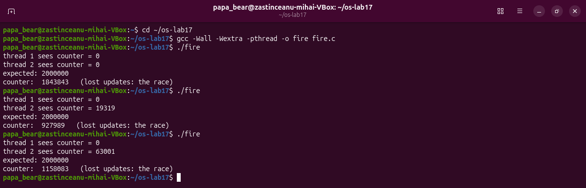
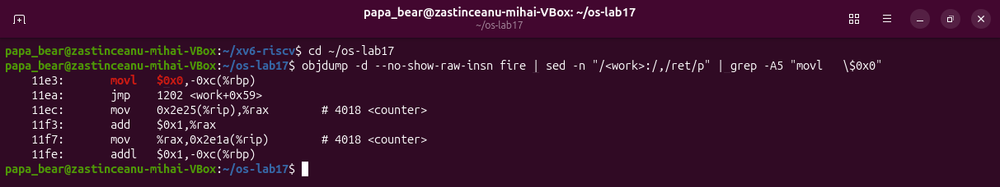
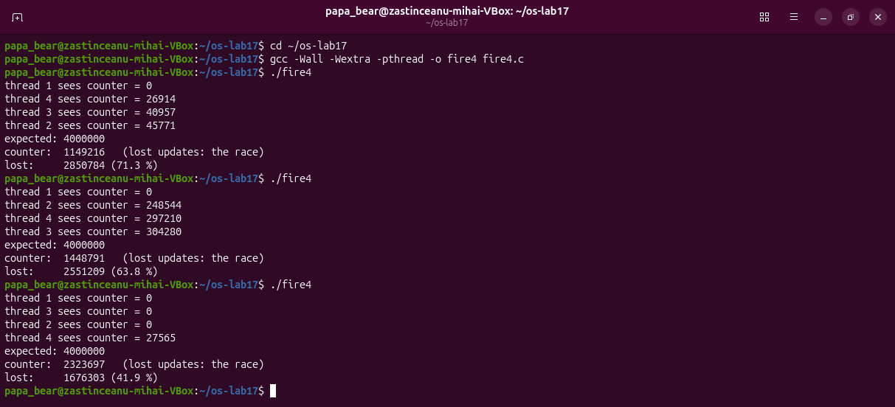

# Lab 17 – Threads Share Memory, and Race (Linux)

Zastinceanu Mihai, FAF-243. The complete report is also available as the .docx file.

## AIM OF THE WORK

### Purpose of the practical work

The purpose of the work is to see both sides of the fact that the threads of one process share the same memory: a value written by one thread is seen at once by the other, and when two or more threads change the same variable without protection, some of the changes are lost [1]. The work was done on the course virtual machine (Ubuntu 26.04.1 LTS, Linux 7.0.0-42-generic, 4 virtual processors) with gcc 15.2.0; both programs were compiled with gcc -Wall -Wextra -pthread, without -O2, and without warnings.

### Problem statement

The following tasks have to be solved:

- to type and run fire.c, in which two threads add 1 to the same counter one million times each, without a lock, and to run it several times
- to explain why the second thread already sees a non-zero counter, and why the final counter is smaller than 2 000 000 and different at every run
- to add two more threads (fire4.c, four threads in total), to compare the loss, and to propose one idea that makes counter++ safe

## 1 SHARED AND RACING

### 1.1 Theoretical background

A process has one address space; a thread is a flow of execution inside it, with its own registers and its own stack, but the global variables, the heap and the open files belong to the process and are therefore shared by all of its threads [2]. pthread_create starts a new thread that runs a given function with one argument, and pthread_join waits for a thread to finish. On a machine with several processors the threads of one process really run at the same time, and the scheduler can also stop a thread between any two machine instructions [3].

### 1.2 Work performed

The program fire.c (Listing 1.1) was typed exactly as in the handout, compiled and run three times (Figure 1.1). The result was never 2 000 000: the three runs gave 1 843 843, 927 989 and 1 158 083, so 7.8 %, 53.6 % and 42.1 % of the additions were lost. Three more runs gave 1 209 158, 1 450 921 and 1 155 131. In two of the three runs of the figure, thread 2 printed a non-zero counter at its start (19 319 and 63 001); in the first run it printed 0 because it reached its printf before thread 1 had begun the loop.

```
/* fire.c - two threads of one process share the same memory.
 * Both add to the same counter, a million times each, WITHOUT a lock.
 * Build: gcc -Wall -Wextra -pthread -o fire fire.c   Run: ./fire
 */
#include <stdio.h>
#include <pthread.h>

#define N 1000000
long counter = 0;              /* one variable, shared by both threads */

void *work(void *arg) {
    long id = (long)arg;
    printf("thread %ld sees counter = %ld\n", id, counter);
    for (int i = 0; i < N; i++)
        counter++;             /* NOT atomic: read, add, write */
    return NULL;
}

int main(void) {
    pthread_t a, b;
    pthread_create(&a, NULL, work, (void *)1);
    pthread_create(&b, NULL, work, (void *)2);
    pthread_join(a, NULL);
    pthread_join(b, NULL);
    printf("expected: %d\n", 2 * N);
    printf("counter:  %ld   (lost updates: the race)\n", counter);
    return 0;
}
```

*Listing 1.1 – The program fire.c*



*Figure 1.1 – Three runs of fire.c: a different, too small result each time*

To see the three steps of counter++, the loop of the function work was disassembled with objdump (Figure 1.2). The single line of C becomes three machine instructions: mov 0x2e25(%rip),%rax reads counter from memory into the register rax, add $0x1,%rax adds one inside the register, and mov %rax,0x2e1a(%rip) writes the register back to counter. Both instructions use the same address 4018, the global variable counter.



*Figure 1.2 – counter++ in machine code: read, add, write*

### 1.3 Answers to the questions

Question 1. Thread 2 printed counter = 19 319 and 63 001 although it never wrote to the variable: the only code that changes counter at that moment is the loop of thread 1. Thread 2 therefore reads the same memory location that thread 1 writes, and it sees the writes immediately, without any copy, message or system call. This proves that the two threads do not have private copies of the global variable, as two processes after fork would have, but share one address space: there is one counter in the whole process.

Question 2. counter++ is not one operation but three: read counter into a register, add 1 to the register, write the register back to counter (Figure 1.2). The two threads run on different processors at the same time, and a thread can also be interrupted between the steps. If thread 1 reads 100, thread 2 also reads 100 before thread 1 writes, both add 1 and both write 101, then two additions produced only one increment: one update is lost. This happens many thousands of times in two million increments, so the final counter is always smaller than 2 000 000. How often the two threads overlap depends on the moment each thread starts, on which processors they run, on interrupts and on the other work of the machine, which is different at every run, so the result is different every time.

## 2 MAKE IT WORSE, THEN THINK

### 2.1 Theoretical background

A race condition is a situation in which the result depends on the order in which the threads happen to execute; the part of the code that touches the shared data is the critical section, and the correct solution must guarantee mutual exclusion: at most one thread may be inside the critical section at any moment [3].

### 2.2 Work performed

The program fire4.c (Listing 2.1) is the same program with four threads, created and joined in a loop; it also prints the number and the percentage of lost updates. It was run three times (Figure 2.1). The expected value is now 4 000 000, but the counters were 1 149 216, 1 448 791 and 2 323 697, so 71.3 %, 63.8 % and 41.9 % of the additions were lost; three more runs lost 66.5 %, 76.1 % and 71.6 %. With two threads the loss was between 7.8 % and 53.6 % (on average about 40 %), with four threads it was between 41.9 % and 76.1 % (on average about 65 %): the loss gets bigger, both in absolute numbers and as a share of the work. With four threads on four processors there are more threads between the read and the write of each other, so more increments overwrite each other, and the cache line that holds counter keeps moving between the processors.

```
/* fire4.c - Part 2: the same race as fire.c, but with FOUR threads.
 * Each thread adds 1 to the shared counter a million times, WITHOUT a lock.
 * Build: gcc -Wall -Wextra -pthread -o fire4 fire4.c   Run: ./fire4
 */
#include <stdio.h>
#include <pthread.h>

#define N 1000000
#define T 4                    /* number of threads */
long counter = 0;              /* one variable, shared by all threads */

void *work(void *arg) {
    long id = (long)arg;
    printf("thread %ld sees counter = %ld\n", id, counter);
    for (int i = 0; i < N; i++)
        counter++;             /* NOT atomic: read, add, write */
    return NULL;
}

int main(void) {
    pthread_t t[T];
    for (long i = 0; i < T; i++)
        pthread_create(&t[i], NULL, work, (void *)(i + 1));
    for (int i = 0; i < T; i++)
        pthread_join(t[i], NULL);
    long lost = (long)T * N - counter;
    printf("expected: %d\n", T * N);
    printf("counter:  %ld   (lost updates: the race)\n", counter);
    printf("lost:     %ld (%.1f %%)\n", lost,
           100.0 * lost / ((double)T * N));
    return 0;
}
```

*Listing 2.1 – The program fire4.c (four threads)*



*Figure 2.1 – Three runs of fire4.c: with four threads even more updates are lost*

### 2.3 The proposed fix

Question 3. The lost updates stop if counter++ becomes a critical section protected by mutual exclusion: a lock (a mutex, or a semaphore that starts at 1) taken before the read and released after the write, so that only one thread at a time can do the three steps. On paper, the loop becomes:

```
pthread_mutex_t m = PTHREAD_MUTEX_INITIALIZER;
...
for (int i = 0; i < N; i++) {
    pthread_mutex_lock(&m);     /* enter: the others wait here */
    counter++;                  /* read, add, write: not interrupted by
                                   another thread that touches counter */
    pthread_mutex_unlock(&m);   /* leave: let the next one in */
}
```

*Listing 2.2 – The proposed fix: a lock around counter++*

The same effect can be obtained with an atomic read-modify-write instruction (for example __atomic_fetch_add or lock add on x86), which does the three steps as one indivisible operation.

## CONCLUSIONS

The work showed both faces of shared memory. The second thread saw, at its very first instruction, a counter that only the first thread had written, so the threads of a process have one common memory and communicate through it with no cost at all. The same fact turns into a bug as soon as two threads change one variable: counter++ is a read, an add and a write, and when the threads interleave these steps, increments overwrite each other.

With two threads between 7.8 % and 53.6 % of two million additions were lost, with four threads between 41.9 % and 76.1 % of four million, and the result was different at every run, which is the typical sign of a race condition. The program has no error a compiler could see; it is correct only if the three steps of counter++ are executed by one thread at a time, which is the job of a lock (mutual exclusion) or of an atomic instruction.

## REFERENCES

1. Threads Share Memory, and Race. Laboratory Work 17, Operating Systems course. FCIM, Technical University of Moldova, 2026.
2. KERRISK, M. pthreads(7), pthread_create(3), pthread_join(3). Linux manual pages [online]. Available: https://man7.org/linux/man-pages/man7/pthreads.7.html
3. ARPACI-DUSSEAU, R. H., ARPACI-DUSSEAU, A. C. Operating Systems: Three Easy Pieces, chapter 26 (Concurrency: An Introduction) [online]. Arpaci-Dusseau Books, 2023. Available: https://pages.cs.wisc.edu/~remzi/OSTEP/threads-intro.pdf
