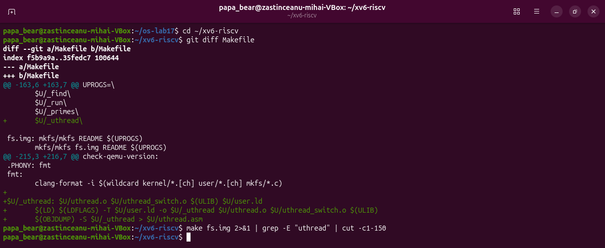
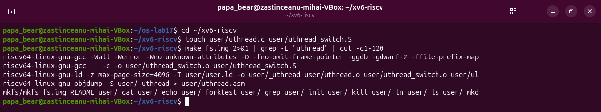
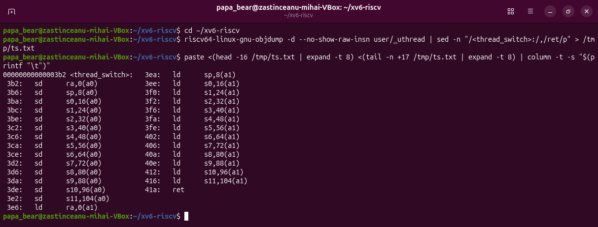
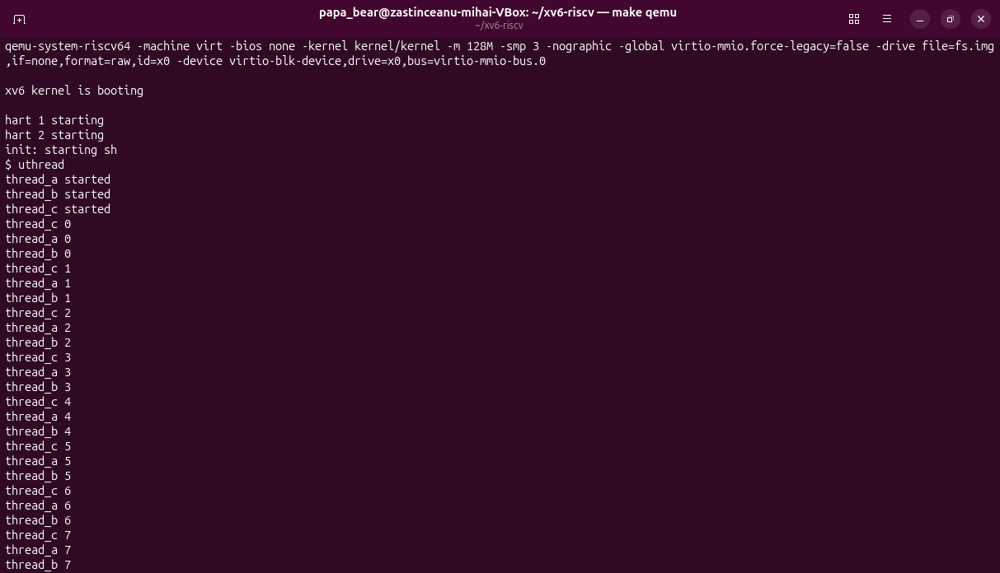
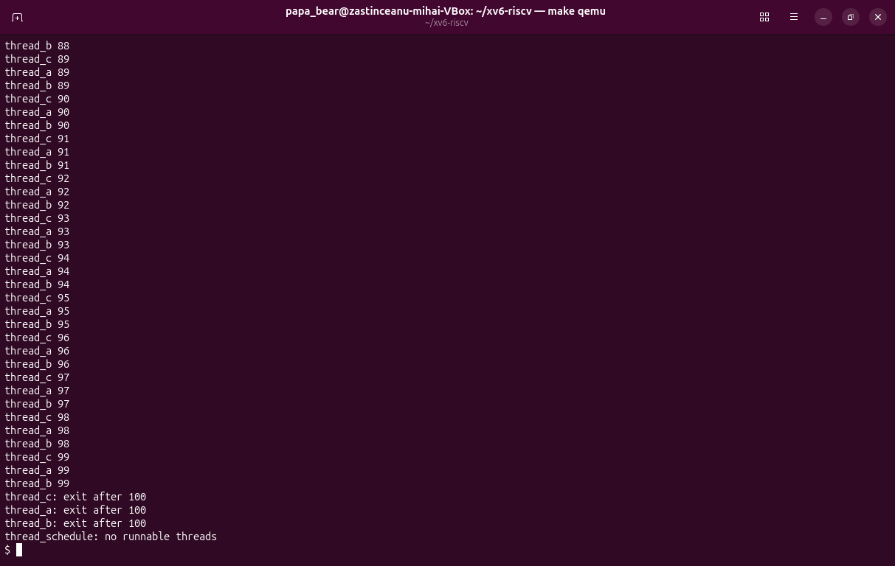

# Lab 18 – Build a User-Level Thread Switch (xv6)

Zastinceanu Mihai, FAF-243. The complete report is also available as the .docx file; the short Observe answer required by the handout is in notes.txt.

## AIM OF THE WORK

### Purpose of the practical work

The purpose of the work is to build a tiny thread library entirely in user space: to create threads and to switch between them by saving and restoring registers, in the same way as the function swtch of the xv6 kernel, but without any change in the kernel [1]. The work was done in the tree ~/xv6-riscv of the course virtual machine (Ubuntu 26.04.1 LTS), on the branch riscv, on top of the changes of Labs 10 and 13; xv6 runs in QEMU with 3 CPUs.

### Problem statement

The following tasks have to be solved:

- to write user/uthread.c from the skeleton of the handout: the fields of struct context, the two lines of thread_create that set ra and sp, and the switch in thread_schedule, plus the threads thread_b and thread_c
- to write the function thread_switch in assembly in user/uthread_switch.S, shaped like the kernel swtch
- to add _uthread to UPROGS and a rule that links uthread.o together with uthread_switch.o in the Makefile
- to run uthread, to check that the three threads take turns up to 99, and to explain what thread_switch saves and why ra makes execution continue in the other thread

## 1 THE SWITCH

### 1.1 Theoretical background

A thread is described completely by its registers and its stack: if the registers of a thread are stored somewhere and later loaded back, the thread continues as if nothing happened. The RISC-V calling convention divides the registers into two groups: the caller-saved ones (ra, a0-a7, t0-t6) may be destroyed by any function call, so the caller saves them if it still needs them, while the callee-saved ones (sp, s0-s11) must have the same value after a call as before it [2]. The xv6 kernel uses exactly this fact in swtch (kernel/swtch.S) [4]: it is called like an ordinary function, it stores ra, sp and s0-s11 of the old context in a struct context and loads the same 14 registers of the new one, and its ret returns into the new thread [3]. A user-level library can do the same thing: the kernel sees one process and does not know about the threads at all, and a thread runs until it gives up the processor itself by calling thread_yield (cooperative scheduling).

### 1.2 Work performed

In user/uthread.c (Listing 1.1) struct context received the 14 fields ra, sp, s0 ... s11, each uint64, so their offsets are 0, 8, 16, ..., 104, the same offsets that the assembly uses. thread_create now sets ctx.ra to the address of the thread function and ctx.sp to the top of the thread's own stack, t->stack + STACK_SIZE, because the stack grows towards lower addresses and the array is aligned to 16 bytes as the calling convention requires. thread_schedule, when it has found another runnable thread, marks it RUNNING, remembers the old thread, makes the next one current and calls thread_switch(&old->ctx, &next_thread->ctx). thread_b and thread_c are copies of thread_a with the letters changed; b waits for the flags of a and c, and c for those of a and b. The rest of the file is the skeleton of the handout.

```
struct context {
  uint64 ra;        /* offset   0: where thread_switch returns to */
  uint64 sp;        /* offset   8: the thread's own stack pointer */
  uint64 s0;        /* offset  16 */
  uint64 s1;        /* offset  24 */
  ...               /* s2 ... s10: offsets 32 ... 96 */
  uint64 s11;       /* offset 104 */
};

void
thread_schedule(void)
{
  ...
  if (current_thread != next_thread) {         /* switch threads?  */
    struct thread *old = current_thread;
    next_thread->state = RUNNING;
    current_thread = next_thread;
    /* save our registers in old->ctx, load the ones of next_thread;
       the call "returns" inside next_thread */
    thread_switch(&old->ctx, &next_thread->ctx);
  }
}

void
thread_create(void (*func)())
{
  ...
  t->state = RUNNABLE;
  /* the first thread_switch into t loads ra and sp from here:
     "ret" jumps to func, which runs on the top of t's own stack
     (the stack grows down, so the top is the END of the array) */
  t->ctx.ra = (uint64)func;
  t->ctx.sp = (uint64)(t->stack + STACK_SIZE);
}
```

*Listing 1.1 – The three filled places of user/uthread.c*

The function thread_switch (Listing 1.2) has the shape of the kernel swtch: a0 points to the context of the old thread and a1 to the context of the new one; 14 sd instructions store ra, sp and s0-s11 at the offsets 0-104 of the old context, 14 ld instructions load them from the new context, and ret ends the function.

```
        .text
        .globl thread_switch
thread_switch:
        sd ra, 0(a0)            # save current thread registers
        sd sp, 8(a0)
        sd s0, 16(a0)
        sd s1, 24(a0)
        ...                     # s2 ... s10 at 32 ... 96
        sd s11, 104(a0)

        ld ra, 0(a1)            # load next thread registers
        ld sp, 8(a1)
        ld s0, 16(a1)
        ld s1, 24(a1)
        ...                     # s2 ... s10 at 32 ... 96
        ld s11, 104(a1)

        ret                     # return into the next thread
```

*Listing 1.2 – thread_switch in user/uthread_switch.S (the full file has all 28 lines)*

In the Makefile, $U/_uthread was added at the end of UPROGS, and a rule was added at the end of the file (Figure 1.1). It is needed because the general rule _%: %.o links only one object file with the library, while _uthread is built from two object files, uthread.o and uthread_switch.o. The rule also writes the disassembly to user/uthread.asm.



*Figure 1.1 – The changes in the Makefile*

After touching the two new files, make compiled uthread.c with -Wall -Werror, assembled uthread_switch.S and linked user/_uthread without any error or warning, and put it into fs.img (Figure 1.2). The disassembly of the program (Figure 1.3) shows that thread_switch is exactly 14 stores relative to a0, 14 loads relative to a1 and one ret: 29 instructions and nothing else.



*Figure 1.2 – uthread is built without errors and added to the file system*



*Figure 1.3 – The disassembly of thread_switch in user/_uthread*

All the changes were saved as one commit on the branch riscv of the xv6 tree ("Lab 18: user-level threads"), and the commit was exported as uthread.patch; no file of the kernel was changed.

## 2 RUN IT

### 2.1 Theoretical background

In the program of the handout, main is thread 0: thread_init marks it RUNNING, then it creates the three threads, marks itself FREE and calls thread_schedule, which never returns to it. thread_schedule looks for the next RUNNABLE thread in round-robin order, starting after the current one; when no thread is runnable, it prints thread_schedule: no runnable threads and exits [1].

### 2.2 Work performed

xv6 was started with make qemu and uthread was run (Figures 2.1 and 2.2). The output is exactly the one of the handout: thread_a started, thread_b started, thread_c started, then thread_c 0, thread_a 0, thread_b 0, thread_c 1, and so on, the three threads taking strict turns until thread_c 99, thread_a 99, thread_b 99, then thread_c: exit after 100, thread_a: exit after 100, thread_b: exit after 100, and finally thread_schedule: no runnable threads, after which the xv6 shell prompt came back. The same run under the script that drives xv6 without the GUI produced 300 counting lines, 100 for each thread.



*Figure 2.1 – The start of the run: the threads start, then take turns c, a, b*



*Figure 2.2 – The end of the run: every thread counts to 99 and exits after 100*

The order c, a, b is explained by the start flags. Thread a runs first, sets a_started and yields because b and c have not started; b does the same. Thread c finds both flags already set, so it does not wait: it prints thread_c 0 and yields. Then a and b leave their waiting loops and print their 0. From then on every thread yields after each line, and the round robin keeps the order c, a, b until the end; the threads also exit in this order.

### 2.3 Answer to the question

What thread_switch saves and loads. It saves into the context of the old thread (a0) and loads from the context of the next thread (a1) exactly 14 registers of 8 bytes, 112 bytes in total: ra at offset 0, sp at offset 8, and s0 to s11 at offsets 16 to 104, which are the callee-saved registers of RISC-V plus the return address. The other registers do not have to be saved: thread_switch is called as a normal C function, so the compiler has already saved on the thread's stack the caller-saved registers (a0-a7, t0-t6) that the caller still needs. The pc is not saved either, because ra already says where the thread has to continue. Loading sp is what moves the processor onto the stack of the next thread, where its local variables, return addresses and saved registers are.

Why ra makes execution continue in the other thread. The last instruction, ret, is jalr x0, 0(ra): a jump to the address that is in ra. Before ret, ra was replaced with the value of the next thread, so ret does not go back to the code that has just called thread_switch, but to the place right after the call to thread_switch that the next thread made the last time it ran, in its own thread_schedule, on its own stack. From there it returns from thread_schedule and thread_yield and continues its loop. For a thread that has never run, thread_create put the address of the thread function in ctx.ra and the top of its stack in ctx.sp, so its first ret jumps to the beginning of thread_a, thread_b or thread_c. This is the trap of the handout: without these two lines ra and sp would be 0, and the first switch would jump to address 0 with no stack.

## CONCLUSIONS

A thread switch turned out to be very little code: 14 stores, 14 loads and a ret. Because thread_switch is called like an ordinary function, only the callee-saved registers, the stack pointer and the return address have to be saved; the calling convention takes care of everything else. The return address is the register that really changes the thread: ret jumps to the ra of the next thread, which continues after its own last call to thread_switch, or, the first time, at the start of its function, on the stack prepared by thread_create.

The program uthread printed exactly the expected output: three threads took strict turns 100 times each and then exited, all inside one xv6 process and without any change in the kernel. The kernel switches between processes with the same mechanism (swtch and struct context); the difference is that the kernel threads are switched at a timer interrupt, while these user threads switch only when they call thread_yield, so a thread that never yields would keep the processor for itself.

## REFERENCES

1. Build a User-Level Thread Switch. Laboratory Work 18, Operating Systems course. FCIM, Technical University of Moldova, 2026.
2. RISC-V International. RISC-V ABIs Specification, version 1.0, chapter 1 (Register Convention) [online]. 2022. Available: https://github.com/riscv-non-isa/riscv-elf-psabi-doc
3. COX, R., KAASHOEK, F., MORRIS, R. xv6: a simple, Unix-like teaching operating system, chapter 7 (Scheduling) [online]. MIT, 2024. Available: https://pdos.csail.mit.edu/6.1810/2024/xv6/book-riscv-rev4.pdf
4. xv6 for RISC-V. Source code repository, MIT PDOS [online]. Available: https://github.com/mit-pdos/xv6-riscv
