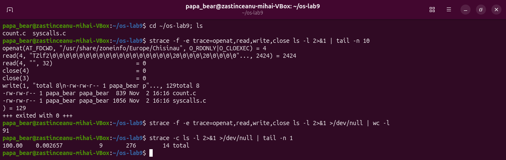
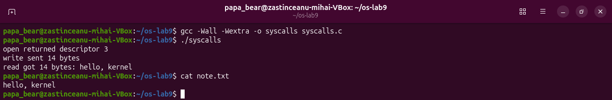
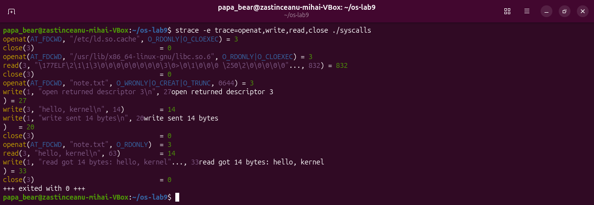
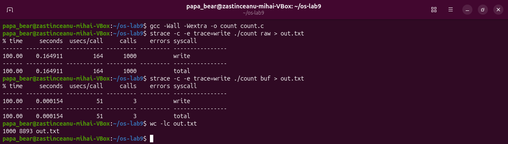
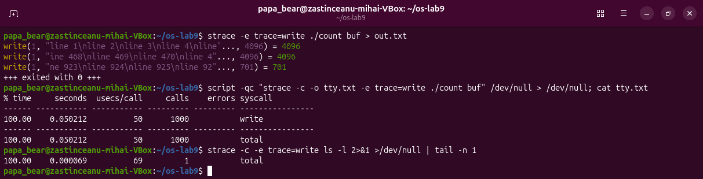

# Lab 9 – Watching System Calls with strace (Linux)

Zastinceanu Mihai, FAF-243. The complete report is also available as the .docx file.

## AIM OF THE WORK

### Purpose of the practical work

The purpose of the work is to watch the border between a program and the kernel, the system call, with the tool strace: first on a real command, then on a small program that uses open, write, read and close directly, and finally by counting one kind of call [1]. The work was done on the course virtual machine (Ubuntu 26.04.1 LTS, Linux 7.0.0-38-generic) with strace 6.19 and gcc 15.2.0; the programs were compiled with -Wall -Wextra without warnings.

### Problem statement

The following tasks have to be solved:

- to run strace on ls -l, to count roughly how many system calls it makes and to find the call that prints to the screen
- to write syscalls.c, which writes a line into a file and reads it back only with system calls, and to watch it with strace
- to count the write calls of a program with strace -c and to explain the difference made by the buffer of the C library

## 1 THE SYSTEM CALLS OF A REAL COMMAND

### 1.1 Theoretical background

A system call is the only way in which a user program can ask the kernel for a service, such as opening a file or printing a text; the program puts the number of the call and its arguments in registers and executes a special instruction that switches the processor into kernel mode [2]. The tool strace starts a program under the control of the ptrace mechanism and prints every system call made by it, with its arguments and its return value; the option -e trace= keeps only the listed calls, -f also follows the children, and -c prints a summary table instead of the individual calls [3].

### 1.2 Work performed

The command ls -l was run under strace with the filter openat, read, write and close (Figure 1.1). Most of the lines are produced before ls prints anything: the dynamic loader opens /etc/ld.so.cache and the shared libraries, then ls opens the directory, the locale files and the time zone files (/usr/share/zoneinfo/Europe/Chisinau) needed to print the dates. The output itself is printed at the very end, by a single call write(1, "total 8\n-rw-rw-r-- 1 papa_bear ..."..., 129) = 129.

Counted with wc -l, the filtered trace has 91 lines, so ls -l makes about 90 calls of these four kinds. The summary of strace -c, which counts all kinds of calls, gives 276 system calls (14 of them returned an error, for example the attempts to connect to the name service socket).



*Figure 1.1 – The last system calls of ls -l and the number of calls*

### 1.3 Answers to the questions

Question 1. ls prints to the screen with the system call write. It writes to the descriptor 1, the standard output, and it prints the whole listing with a single write, because the C library first collects the text in a buffer.

## 2 A PROGRAM THAT CALLS THE KERNEL DIRECTLY

### 2.1 Theoretical background

The functions open, read, write and close of the header unistd.h and fcntl.h are thin wrappers over the system calls with the same names: they only move the arguments into registers and execute the system call instruction [4]. open returns a file descriptor, a small integer that is an index in the table of open files of the process, and the kernel always gives the lowest number that is free [5]. On current Linux systems the C library implements open with the more general call openat, with the first argument AT_FDCWD, which means "relative to the current directory".

### 2.2 Work performed

The program syscalls.c (Listing 2.1) was typed from the handout, compiled and run (Figure 2.1). The output is exactly the expected one: open returned the descriptor 3, write sent 14 bytes, and read got back the same 14 bytes "hello, kernel"; cat confirmed the content of note.txt.

```
/* syscalls.c - open, write, read and close, using only system calls.
 * Build:  gcc -Wall -Wextra -o syscalls syscalls.c
 * Run:    ./syscalls
 * See the calls: strace ./syscalls
 */
#include <fcntl.h>      /* open */
#include <unistd.h>     /* write, read, close */
#include <string.h>     /* strlen */
#include <stdio.h>      /* printf */

int main(void) {
    const char *msg = "hello, kernel\n";

    /* open() is a system call: ask the kernel for a file, get back a descriptor */
    int fd = open("note.txt", O_CREAT | O_WRONLY | O_TRUNC, 0644);
    if (fd < 0) { perror("open"); return 1; }
    printf("open returned descriptor %d\n", fd);

    /* write() is a system call: hand the bytes to the kernel */
    ssize_t n = write(fd, msg, strlen(msg));
    printf("write sent %zd bytes\n", n);
    close(fd);

    /* read it back, through the kernel again */
    fd = open("note.txt", O_RDONLY);
    char buf[64];
    n = read(fd, buf, sizeof(buf) - 1);
    buf[n] = '\0';
    printf("read got %zd bytes: %s", n, buf);
    close(fd);
    return 0;
}
```

*Listing 2.1 – The program syscalls.c*



*Figure 2.1 – Compiling and running syscalls*

Then the program was run under strace -e trace=openat,write,read,close (Figure 2.2). The first five lines belong to the dynamic loader, which opens /etc/ld.so.cache and libc.so.6 and reads the ELF header of the library. After them come exactly the calls of the program: openat(AT_FDCWD, "note.txt", O_WRONLY|O_CREAT|O_TRUNC, 0644) = 3, write(3, "hello, kernel\n", 14) = 14, close(3) = 0, openat(AT_FDCWD, "note.txt", O_RDONLY) = 3, read(3, "hello, kernel\n", 63) = 14 and close(3) = 0. The C call open became the system call openat, and read asked for 63 bytes (sizeof(buf) - 1) but received only the 14 bytes that exist in the file.

Between these lines the trace also shows the calls write(1, ...) made by printf. Because the standard output was the terminal, every printf line was sent at once, so the text of the program appears in the middle of the trace lines. When the output was not a terminal (for example through a pipe), the three lines were sent together by a single write(1, ..., 80) at the end of the program.



*Figure 2.2 – The system calls of syscalls, seen by strace*

### 2.3 Answers to the questions

Question 1. The descriptors 0, 1 and 2 are already taken because every process starts with three open files, inherited from the shell that started it: 0 is the standard input, 1 the standard output and 2 the standard error, all connected here to the terminal. open always returns the lowest free descriptor, so the first file opened by the program receives 3. After close(3) the number 3 is free again, so the second openat also returns 3.

## 3 COUNTING ONE KIND OF CALL

### 3.1 Theoretical background

The option -c of strace counts the system calls instead of printing them, and together with -e trace=write it counts only one kind of call [3]. The functions of stdio, such as printf, do not call write every time: they collect the text in a buffer of the C library and call write only when the buffer is full, at the end of the program, or at every new line if the output is a terminal (line buffering) [6].

### 3.2 Work performed

To see the difference, the program count.c (Listing 3.1) was written: it prints the same 1000 lines either with one write for every line (argument raw) or with printf (argument buf).

```
/* count.c - print the same 1000 lines in two ways, to count the write calls.
 * Build:  gcc -Wall -Wextra -o count count.c
 * Run:    strace -c -e trace=write ./count raw  > out.txt
 *         strace -c -e trace=write ./count buf  > out.txt
 */
#include <stdio.h>      /* printf, snprintf */
#include <string.h>     /* strcmp, strlen */
#include <unistd.h>     /* write */

int main(int argc, char *argv[]) {
    int raw = argc > 1 && strcmp(argv[1], "raw") == 0;
    char line[32];

    for (int i = 1; i <= 1000; i++) {
        if (raw) {
            /* one system call for every line */
            int len = snprintf(line, sizeof(line), "line %d\n", i);
            write(1, line, len);
        } else {
            /* printf only fills a buffer in the C library */
            printf("line %d\n", i);
        }
    }
    return 0;
}
```

*Listing 3.1 – The program count.c*

With the output redirected to the file out.txt, the version raw made 1000 write calls, while the version with printf made only 3 (Figure 3.1). Both produced the same file of 1000 lines and 8893 bytes, and the version with one call per line spent about a thousand times more time in the kernel (0.165 s against 0.00015 s).



*Figure 3.1 – Counting the write calls: 1000 with write, 3 with printf*

The three calls of the version with printf were then printed one by one (Figure 3.2): write(1, ..., 4096), write(1, ..., 4096) and write(1, ..., 701). The C library sent the text in blocks of 4096 bytes, the size of its buffer, and 4096 + 4096 + 701 = 8893 bytes, the size of out.txt. When the same program was run with its output on a terminal (the command script gives it a terminal and strace -o keeps the summary in a file), the count became again 1000, because on a terminal the buffer is emptied at every new line. Finally, ls -l printed its whole listing with only 1 write.



*Figure 3.2 – The blocks of 4096 bytes, and the count on a terminal*

### 3.3 Answers to the questions

Question 1. printf is not a system call: it is a function of the C library that fills a buffer in the memory of the process, and the system call write is made only when the buffer is emptied. That is why the number of write calls depends on where the output goes: 3 calls for 1000 lines in a file, but 1000 calls when the output is a terminal, where the library empties the buffer at every new line so that the user sees each line at once.

Question 2. Each system call costs a switch into the kernel and back, so 1000 small write calls are much slower than 3 large ones; the measured time was about 0.165 s against 0.00015 s. Buffering in the library therefore reduces the number of crossings of the border between the program and the kernel.

## CONCLUSIONS

strace showed that even a simple command such as ls -l makes almost three hundred system calls, most of them before it prints anything: loading the libraries, reading the directory, the locale and the time zone files. The visible result is a single write to the descriptor 1.

The program syscalls.c showed that the C functions open, write, read and close become the real system calls openat, write, read and close with the same arguments, and that the kernel gives the lowest free descriptor, 3, because 0, 1 and 2 are inherited from the shell. Counting the write calls showed the difference between a system call and a library function: printf groups the output in blocks of 4096 bytes, so the same 1000 lines cost 3 system calls in a file instead of 1000.

## REFERENCES

1. Watching System Calls with strace. Laboratory Work 9, Operating Systems course. FCIM, Technical University of Moldova, 2026.
2. syscalls(2). Linux manual page [online]. Available: https://man7.org/linux/man-pages/man2/syscalls.2.html
3. strace(1). Linux manual page [online]. Available: https://man7.org/linux/man-pages/man1/strace.1.html
4. open(2). Linux manual page [online]. Available: https://man7.org/linux/man-pages/man2/open.2.html
5. COX, R., KAASHOEK, F., MORRIS, R. xv6: a simple, Unix-like teaching operating system [online]. MIT, 2024. Available: https://pdos.csail.mit.edu/6.1810/2024/xv6/book-riscv-rev4.pdf
6. setvbuf(3). Linux manual page [online]. Available: https://man7.org/linux/man-pages/man3/setvbuf.3.html
